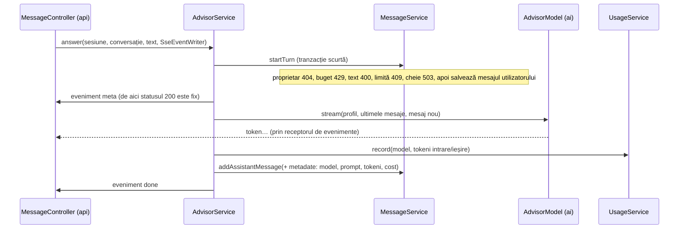

# Backend — arhitectură (stadiul Fazei 5a)

Serviciul din `backend/`: Java 25, Spring Boot, Maven Wrapper. Deține toată logica de produs; frontend-ul doar afișează. Are domeniul, persistența (Flyway + JPA), catalogul de pornire, API-ul REST descris în [`communication.md`](communication.md), identitatea prin token de sesiune anonim, limitele de rată și contabilitatea bugetului zilnic. Din Faza 5a apelează modelul: `POST /conversations/{id}/messages` răspunde în streaming (SSE), vezi „Consilierul” mai jos. Uneltele (căutare, comparare, TCO) vin în 5b–5c, iar garduri și evaluare în 5d.

## Versiuni fixate (verificate la 2026-11-11)

| Componentă         | Versiune | De ce această versiune                                                                                                  |
| ------------------ | -------- | ----------------------------------------------------------------------------------------------------------------------- |
| Java               | 25 (LTS) | Cerută de D9/plan; Temurin 25.0.5. Spring AI 2.0.2 are baza Java 17, deci rulează pe 25.                                |
| Spring Boot        | 4.1.2    | Cea mai nouă linie stabilă; este exact `spring-boot.version` din Spring AI 2.0.2 (4.2 există doar ca RC).               |
| Spring AI          | 2.0.2    | Ultima versiune stabilă (2.1 este încă RC); Initializr o leagă de Boot `>=4.0.0 <4.2.0`.                                |
| springdoc-openapi  | 3.2.0    | Linia pentru Boot `>=4.1`, conform Initializr.                                                                          |
| swagger-core       | 2.2.55   | Fixat explicit — vezi „Capcane” mai jos.                                                                                |
| ArchUnit           | 1.5.1    | Ultima versiune; citește fișiere `.class` Java 25.                                                                      |
| Maven (wrapper)    | 3.10.0   | Din `.mvn/wrapper/maven-wrapper.properties` generat de Initializr; nu se instalează Maven global.                       |

Versiunile sunt în `backend/pom.xml` (părintele Boot și proprietățile `spring-ai.version`, `springdoc.version`, `swagger-core.version`, `archunit.version`). Un upgrade se face deliberat, după ce s-a verificat din nou compatibilitatea Spring AI ↔ Boot ↔ Java.

### Capcane întâlnite

- **springdoc vs Spring AI:** Spring AI aduce `swagger-annotations-jakarta` 2.2.38 și `swagger-annotations` 2.2.31 (prin `openai-java-core`), mai vechi decât 2.2.55 cerut de springdoc 3.2.0. Rezultat: `/v3/api-docs` răspundea 500 cu `NoSuchMethodError: Schema.$dynamicRef()`. Soluția din `pom.xml`: `swagger-annotations-jakarta` fixat la 2.2.55 în `dependencyManagement` și `swagger-annotations` exclus din starter-ul OpenAI. `CpaBackendApplicationTests` păzește acest caz.
- **Fără cheie:** Spring AI 2.0.2 nu oprește aplicația dacă `spring.ai.openai.api-key` este gol; disponibilitatea consilierului se verifică separat (`AdvisorAvailability`).
- **Model:** `gpt-5.6-terra` ([ADR 0010](../adr/0010-model-openai-inlocuitor-gpt-5-mini.md)); predecesorul `gpt-5-mini` se oprește la 2026-12-11 — vezi [`../openai/README.md`](../openai/README.md).

## Straturi

Pachetul de bază este `ro.cpa.advisor` (D9):

| Pachet       | Rol                                                                                                                                                                                  |
| ------------ | ------------------------------------------------------------------------------------------------------------------------------------------------------------------------------------ |
| `api`        | Controllere (`SessionController`, `ProfileController`, `ConversationController`, `MessageController`, `ShortlistController`, `VehicleController`, `UsageController`, `HealthController`), DTO-urile de cerere (record-uri cu Bean Validation, imbricate în controller) și `ApiExceptionHandler` (`ProblemDetail`). Răspunsurile sunt record-urile din `domain`. |
| `service`    | Cazurile de utilizare: `SessionService`, `ProfileService`, `ConversationService`, `MessageService`, `AdvisorService` (un schimb complet cu consilierul), `ShortlistService`, `VehicleService`, `UsageService` (consum + buget), `RateLimitService`, `StatusService`. Tranzacțiile (`@Transactional`) stau aici (nu pe `AdvisorService`, vezi „Consilierul”); maparea entitate → domeniu se face aici. |
| `domain`     | Record-uri și enum-uri imuabile (`BuyerProfile`, `Vehicle`, `Message`…), regulile pure (`TextRules` — curățarea textului, `SessionToken` — generare și hash, `VehicleFilter`) și excepțiile de domeniu. Nu depinde de nimic în afară de `java.*`. |
| `repository` | Entitățile JPA (`*Entity`), repository-urile Spring Data și convertoarele de coloană. Entitățile **nu** ies din acest strat și din `service`: controllerele nu le văd. Cum domeniul nu poate depinde de `jakarta.persistence`, entitățile sunt separate de record-urile de domeniu (`toDomain()`). |
| `ai`         | Tot ce atinge modelul: `AdvisorPrompt` (**singurul** loc care compune promptul de sistem, versionat), `AdvisorModel` (frontiera spre model, pe care o cunosc serviciile), `SpringAiAdvisorModel` (implementarea cu `ChatClient`), `AdvisorAvailability` (există o cheie utilizabilă? valoarea ei nu iese de aici). Spring AI nu apare în afara acestui pachet (regulă ArchUnit). |
| `config`     | `CpaProperties`, `SecurityConfig` (lanțul de securitate + CORS), `SessionAuthenticationFilter`, `RateLimitFilter`, `ClientIpResolver`, `RequestIdFilter`, `OpenApiConfig`, `ClockConfig`, `StreamConfig` (firul pentru heartbeat-ul SSE). |

Regulile `api → service → repository`, `service → domain`, `ai` folosit doar de `service`, `domain` fără dependențe, controllere fără acces la repository sau Spring AI sunt verificate de `ArchitectureTest` (ArchUnit) la fiecare `./mvnw verify`.

## Configurare

`backend/src/main/resources/application.yml`; valorile secrete vin din mediu sau din `backend/.env` (citit automat, gitignorat). Șablonul este `backend/.env.example`.

| Proprietate / variabilă                              | Implicit                  | Rol                                                                                  |
| ---------------------------------------------------- | ------------------------- | ------------------------------------------------------------------------------------ |
| `OPENAI_API_KEY` → `spring.ai.openai.api-key`        | gol                       | Cheia OpenAI; doar în backend. Lipsa ei nu oprește aplicația.                        |
| `CPA_LLM_MODEL` → `cpa.llm.model`                    | `gpt-5.6-terra`           | Singurul model folosit (ADR 0007, modelul din ADR 0010).                             |
| `CORS_ALLOWED_ORIGINS` → `cpa.cors.allowed-origins`  | `http://localhost:3000` (în `prod`: fără implicit) | Origini separate prin virgulă; `*` este refuzat la pornire.                 |
| `SPRING_PROFILES_ACTIVE`                             | niciunul (dezvoltare)     | `prod` pe Render: activează `application-prod.yml` (vezi mai jos).                   |
| `CPA_TRUSTED_PROXY_HOPS` → `cpa.limits.trusted-proxy-hops` | `0` local, `1` în `prod` | Câte proxy-uri de încredere sunt între internet și aplicație, pentru adresa IP din limitele de rată (vezi „Limite de rată și buget”). |
| `cpa.llm.*` (în `application.yml`)                   | `max-output-tokens: 4000`, `history-messages: 20`, prețuri 2 / 12 USD | Plafonul de tokeni generați, câte mesaje recente intră în prompt și prețurile (USD / milion de tokeni) pentru jurnalul de cost; se schimbă în fișier. |
| `cpa.stream.heartbeat-seconds`                       | `15`                      | Intervalul comentariului SSE de heartbeat.                                           |
| `cpa.limits.*` (în `application.yml`)                | vezi „Limite de rată și buget” | Limite de rată, de volum și buget zilnic de tokeni; se schimbă în fișier, nu din mediu. |
| `SPRING_DATASOURCE_URL` / `_USERNAME` / `_PASSWORD`  | H2 în memorie (mod PostgreSQL); în `prod` URL-ul e obligatoriu | Baza de date; în producție Neon (URL JDBC, vezi [`../neon/README.md`](../neon/README.md)). |

Alte setări: `spring.threads.virtual.enabled=true` (thread-uri virtuale), `spring.jpa.open-in-view=false`, Actuator expune doar `health`.

### Baza de date și Flyway

- Flyway rulează la pornire pe orice bază configurată; migrările sunt în `backend/src/main/resources/db/migration/` (`V<număr>__<descriere>.sql`). Regula: aceeași migrare trebuie să treacă pe H2 (mod PostgreSQL) și pe PostgreSQL, deci SQL standard. O migrare deja aplicată (pe Neon) **nu se editează niciodată**; se adaugă una nouă.
  - `V1__baseline.sql` — goală, intenționat (Faza 3: dovedește că Flyway rulează).
  - `V2__domain_schema.sql` — tabelele din plan §2.2.
  - `V3__seed_catalogue.sql` — catalogul de pornire: 14 modele, 21 de variante.
- Alegeri de schemă făcute ca să meargă pe ambele motoare: id-urile datelor unui vizitator sunt `uuid` generat de aplicație (fără secvențe/identity); textul liber este `varchar(n)`, nu `text` (pe H2 `text` devine CLOB și Hibernate îl respinge la validare); JSON-ul din `message.metadata` este text simplu, nu `jsonb`; enum-urile se salvează ca text, cu constrângeri `check`; listele scurte (tipuri de caroserie, motorizări, condiții) sunt text separat prin virgulă / `\n`, printr-un `AttributeConverter`, nu tabele de legătură.
- Stergerea în cascadă: `visitor_session` → `buyer_profile`, `conversation` → `message`, `shortlist_item` (`on delete cascade`). `usage_log.session_id` este `on delete set null`: „șterge-mi datele” nu trebuie să reseteze bugetul global zilnic.
- **Catalogul** este curatat de mână și **neverificat** față de listele de preț ale dealerilor: cifrele sunt rotunjite și orientative (`data_as_of` = 2026-11-11, afișat în UI ca „date la”). `euro_ncap_stars` este `NULL` când nu există o sursă sigură. Trebuie revizuit și extins înainte de producție (Faza 9); `plan.md` prevede ~100–200 de variante.
- `ddl-auto: validate`: Hibernate nu creează tabele; orice nepotrivire dintre entități și schemă oprește pornirea (și pică testele de repository).
- Dovada: `RepositoryH2Test` și `RepositoryPostgresTest` rulează **aceleași** verificări (`RepositoryContract`) pe H2 și pe PostgreSQL 17 (Testcontainers), deci migrările și maparea JPA sunt verificate pe ambele motoare la fiecare `./mvnw verify`.

### Limite de rată și buget

Configurate în `cpa.limits.*` (`application.yml`; valorile implicite sunt în [`communication.md`](communication.md#limite-și-buget)):

- **Rata** (Bucket4j, în memorie, **per instanță**): per sesiune, per IP și sesiuni noi per IP. Planul Free rulează o singură instanță, deci nu e nevoie de stare comună; la scalare orizontală ar trebui mutată într-un depozit comun. Galețile stau într-un cache Caffeine cu expirare (cheile vin de la client, deci harta nu are voie să crească nemărginit).
- **IP-ul clientului:** în `prod`, `trusted-proxy-hops: 1` — se ia ultima intrare din `X-Forwarded-For` (adăugată de proxy-ul Render); intrările din stânga le scrie clientul și sunt ignorate. **Presupunerea că Render adaugă exact o intrare nu este încă verificată pe instanța reală** — de verificat în Faza 9 (altfel limitele per IP ar fi comune tuturor, sau ocolibile). `CPA_TRUSTED_PROXY_HOPS` o poate corecta fără cod.
- **Volum** per sesiune (conversații, mesaje, lista scurtă): verificat în servicii, cu `409 limit-reached`. Verificarea nu este atomică: două cereri simultane pot depăși o limită cu 1–2 elemente; este acceptabil (limita e un plafon de abuz, nu o regulă de facturare).
- **Buget zilnic de tokeni** (ziua UTC): `UsageService.assertWithinBudget` rulează **înainte** de orice muncă costisitoare, pe sesiune și global; `record` îl alimentează după fiecare răspuns al modelului (`AdvisorService`, și pentru răspunsuri întrerupte, cu tokeni estimați). Bugetul este un plafon „moale”: un răspuns început în limită poate depăși bugetul cu cel mult un răspuns (`max-output-tokens`), iar două cereri simultane ale aceleiași sesiuni pot trece amândouă de verificare. „Întrerupătorul global” este chiar bugetul global.
- Filtrele (`SessionAuthenticationFilter`, `RateLimitFilter`) sunt create în lanțul de securitate, nu sunt bean-uri, ca Boot să nu le înregistreze a doua oară ca filtre servlet. Erorile lor (401/403/429) trec prin același `ApiExceptionHandler`, deci au forma `ProblemDetail`.

### Profilul `prod` (`application-prod.yml`)

Activat pe Render prin `SPRING_PROFILES_ACTIVE=prod`. Alegerile specifice gazdei stau aici, ca dezvoltarea locală să rămână simplă:

| Setare                                                          | De ce                                                                                                             |
| --------------------------------------------------------------- | ----------------------------------------------------------------------------------------------------------------- |
| `spring.datasource.url: ${SPRING_DATASOURCE_URL}` (fără implicit) | Fără URL aplicația nu pornește; un H2 în memorie ar „funcționa" și ar pierde datele la fiecare repornire.         |
| `cpa.cors.allowed-origins: ${CORS_ALLOWED_ORIGINS}` (fără implicit) | Lista exactă de origini se setează explicit în producție; fără `localhost` moștenit.                            |
| Hikari: `max-lifetime` 240 s, `idle-timeout` 60 s, `minimum-idle` 0, `maximum-pool-size` 5, `connection-timeout` 30 s, `validation-timeout` 5 s | Neon Free adoarme după 5 min și închide conexiunile; o conexiune veche nu se refolosește, una inactivă e validată înainte de folosire. Pool mic: 512 MB RAM pe Render. |
| Hikari `initialization-fail-timeout: 60000`                     | La pornire așteptăm până la 60 s trezirea bazei, în loc să cădem la prima încercare.                             |
| Flyway `connect-retries: 5`, `connect-retries-interval: 3s`     | Reîncearcă conectarea la migrare dacă baza încă se trezește.                                                     |
| Fără `keepalive-time` (intenționat)                             | Ar ține Neon treaz non-stop și ar consuma cele 100 CU-ore gratuite.                                              |
| `management.health.db.enabled: false`                           | `/actuator/health` e apelat des (health check Render, ping-ul frontend-ului); nu trebuie să trezească Neon. Disponibilitatea bazei nu are încă un grup de readiness separat (amânat de la Faza 4 la Faza 9). |
| `springdoc.api-docs.enabled: false`, `springdoc.swagger-ui.enabled: false` | Swagger UI și `/v3/api-docs` nu sunt publice în producție (404). Rămân active local și în CI.            |

Verificat la 2026-11-11 cu imaginea Docker a backend-ului pe un container PostgreSQL 17 (profil `prod`, `PORT=10000`, 512 MB): Flyway aplică `V1`, `/api/v1/health` răspunde, `/v3/api-docs` dă `404`, CORS acceptă doar originea configurată, iar pornirea cu baza oprită așteaptă și își revine când baza revine. `ProductionProfileTest` păzește partea fără bază reală (Swagger oprit, fără `dbHealthIndicator`).

## Securitate și erori

- **Fără stare:** fără sesiune de server, cookie sau login. Identitatea este tokenul anonim din `Authorization: Bearer` (hash-uit în baza de date, vezi [`communication.md`](communication.md#sesiune-și-autentificare)). Publice: `/api/v1/health`, `POST /api/v1/sessions`, `/actuator/health`, `/v3/api-docs`, `/swagger-ui`. Orice altceva din `/api/v1/**` cere token (`401`); orice cale din afara lor este refuzată.
- **CORS:** doar originile din listă, metodele `GET/POST/PUT/PATCH/DELETE/OPTIONS`, headerele `Authorization`, `Content-Type`, `X-Request-Id`; expune `X-Request-Id` și `Retry-After`; fără credentials. Strategia pentru Vercel (Production exact, Preview doar prin aliasul stabil al branch-ului, fără wildcard) este în [`../vercel/README.md`](../vercel/README.md#cors-production-vs-preview).
- **Id de cerere:** `RequestIdFilter` pune `X-Request-Id` în răspuns și în fiecare linie de log; un id primit de la client se acceptă doar dacă este inofensiv (`[A-Za-z0-9-]{8,64}`).
- **Date din browser = date nefiduciare:** `TextRules` (în `domain`) curăță orice text liber la intrare (fără caractere de control sau invizibile, spații colapsate) și îl refuză, nu îl taie, dacă e prea lung; profilul și mesajele intră în prompt abia după asta, **delimitate ca date** (`<buyer_profile>`, `<user_message>`), cu `<` și `>` din text înlocuite ca să nu poată închide sau falsifica o etichetă (`AdvisorPrompt`, testat).
- **Izolarea sesiunilor:** fiecare interogare de conversație/element include `session_id`; un id al altcuiva dă `404`, ca unul inexistent (`sessionsCannotSeeEachOthersData`).
- **Erori:** toate ies ca `ProblemDetail` (RFC 9457) cu `requestId` și `code` stabil; catalogul complet este în [`communication.md`](communication.md#erori). Orice excepție neprevăzută → `500` generic, fără detalii interne.
- **Swagger UI și `/v3/api-docs`** sunt deschise local și în CI, dar **oprite în producție** (profilul `prod`, `404`) — decis în Faza 3; se reconsideră în Faza 9 doar dacă există un motiv.

## Consilierul (Faza 5a)

Drumul unui mesaj, de la `POST /api/v1/conversations/{id}/messages` până la ultimul eveniment SSE:



- **Verificările sunt înaintea modelului și înaintea primului octet.** O eroare de acolo este un răspuns HTTP obișnuit `problem+json`, chiar dacă clientul cere `Accept: text/event-stream`. Cheia lipsă (`503`) este verificată **ultima**: nu maschează o eroare a utilizatorului și nu lasă în urmă un mesaj fără răspuns.
- **Nicio tranzacție nu rămâne deschisă cât ține apelul către model.** `AdvisorService` nu este `@Transactional`; fiecare pas de bază de date este o tranzacție scurtă (o conexiune blocată câteva secunde ar înfometa pool-ul mic de pe Neon).
- **SSE fără `SseEmitter`:** `SseEventWriter` scrie direct în răspuns, pe firul virtual al cererii (blocarea e ieftină), cu un heartbeat (`: keep-alive`) trimis de un fir daemon. Fără dispatch asincron, cererea nu mai trece a doua oară prin lanțul de securitate. Dacă clientul închide conexiunea, scrierea eșuează, `StreamClosedException` oprește apelul către model, iar consumul se înregistrează **estimat** (o oprire nu e gratuită).
- **Prompt:** `AdvisorPrompt.system(profil)` este singurul loc care compune persona (versiunea, `AdvisorPrompt.VERSION`, se salvează în metadatele fiecărui răspuns). Mesajele se trimit ca obiecte `Message`, nu prin `ChatClient.user(String)`: acela tratează `{…}` ca parametri de șablon, deci un mesaj cu acolade ar putea strica sau manipula promptul.
- **Memorie (5a):** ultimele `cpa.llm.history-messages` mesaje + profilul structurat. Rezumatul rulant vine în 5d.
- **Consum și cost:** tokenii raportați de OpenAI (`stream_options.include_usage`); dacă lipsesc, se estimează (~4 caractere/token). Fiecare răspuns scrie în jurnal o linie `Advisor answer: model=… promptVersion=… inputTokens=… outputTokens=… costUsd=…` (doar cifre, fără id-uri sau text) și aceleași cifre în `message.metadata`.
- **Erori în timpul fluxului:** `error` cu `code: advisor-unavailable` (aceeași formă ca `ProblemDetail`), fără mesajul furnizorului: mesajele OpenAI pot conține fragmente de cheie, deci în jurnal intră doar tipul excepției, iar logger-ul Spring AI care ar scrie mesajul întreg (`MessageAggregator`) este oprit în `application.yml`.
- **Ipoteze nevalidate cu o cheie reală** (de verificat la prima rulare, vezi [`../openai/README.md`](../openai/README.md#verificare)): că `gpt-5.6-terra` acceptă `max_completion_tokens` și `stream_options` prin Chat Completions așa cum le trimite Spring AI 2.0.2, și că ultimul raport de consum dintr-un flux este totalul (relevant când apar uneltele în 5b).

## Teste

`./mvnw verify` (din `backend/`, cu JDK 25; **Docker trebuie să ruleze**, pentru Testcontainers) rulează:

- unitare: domeniu (`DomainRulesTest`), `ClientIpResolver`, `AdvisorAvailability`, `CpaProperties`, `RequestIdFilter`, `ApiExceptionHandler`, `AdvisorPrompt` (delimitarea datelor), `SseEventWriter`, `SpringAiAdvisorModel` (ordinea mesajelor, consum, întrerupere, eșec);
- repository, aceleași verificări pe H2 și pe PostgreSQL 17 real (`RepositoryH2Test`, `RepositoryPostgresTest`);
- contract REST cap-coadă pe H2 cu migrările reale (`ApiContractTest`: autentificare, profil, conversații, lista scurtă, catalog, izolarea sesiunilor, „șterge-mi datele”), limite (`RateLimitTest`) și buget (`DailyBudgetTest`);
- fluxul SSE cap-coadă (`AdvisorStreamingTest`): ordinea evenimentelor, salvarea răspunsului, consumul, eșecul din timpul fluxului, heartbeat, erori dinaintea fluxului, promptul ajuns la model. **Modelul este unul înregistrat** (`RecordedChatModel`, în `src/test`): înlocuiește `ChatModel`-ul OpenAI, deci tot restul drumului rulează ca în producție, fără rețea și fără cheie; testele setează `spring.ai.openai.api-key` la un substituent (`RecordedAdvisorConfig`) doar ca să apară ca „configurat”;
- `@WebMvcTest` pentru statusul public și CORS, pornirea completă **fără** cheie OpenAI (inclusiv `503` la mesaj), profilul `prod` pe H2;
- `OpenApiSnapshotTest`: `docs/architecture/openapi.json` trebuie să fie identic cu documentul generat (regenerare: `./mvnw test -Dtest=OpenApiSnapshotTest -Dopenapi.update=true`);
- `ArchitectureTest` (ArchUnit): straturile din plan §2.2.

Fără Docker, doar `RepositoryPostgresTest` pică (zgomotos, intenționat): `./mvnw verify -Dtest='!RepositoryPostgresTest'` rulează restul.

## Docker și CI

- `backend/Dockerfile`: build în două etape (`eclipse-temurin:25-jdk` → `eclipse-temurin:25-jre`), jar „layered”, utilizator fără drept de root, `-XX:MaxRAMPercentage=60 -XX:+UseSerialGC` (60% fiindcă planul Render Free are 512 MB), portul din `$PORT` (implicit 8080; Render injectează `10000`). Imaginea se construiește cu `-DskipTests` (testele rulează în CI și local, nu în build-ul Docker).
- `render.yaml` (rădăcina repo-ului): Blueprint-ul serviciului Render — Docker, `dockerfilePath: ./backend/Dockerfile`, `dockerContext: ./backend`, plan `free`, regiunea `frankfurt`, health check `/actuator/health`, variabilele secrete declarate cu `sync: false`. Detalii: [`../render/README.md`](../render/README.md).
- `.github/workflows/backend.yml`: `./mvnw verify` cu Temurin 25 (runner-ul `ubuntu-latest` are Docker, deci rulează și Testcontainers; include verificarea instantaneului OpenAPI), apoi `docker build`; rulează când se schimbă `backend/`, `docs/architecture/openapi.json` sau workflow-ul. `.github/workflows/frontend.yml` face același lucru pentru `frontend/` (`npm ci`, `lint`, `format:check`, `build`).
- Compatibilitatea gazdei și limitele Neon sunt în [`../render/README.md`](../render/README.md) și [`../neon/README.md`](../neon/README.md).

## Rulare locală

```bash
cd backend
cp .env.example .env        # opțional; fără el aplicația pornește fără cheie
./mvnw spring-boot:run      # http://localhost:8080  (JAVA_HOME trebuie să indice JDK 25)
```

- Status: `http://localhost:8080/api/v1/health`
- OpenAPI: `http://localhost:8080/v3/api-docs` · Swagger UI: `http://localhost:8080/swagger-ui.html`
- Sănătate pentru gazdă: `http://localhost:8080/actuator/health`
