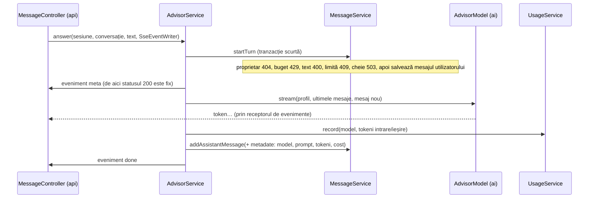

# Backend — arhitectură (stadiul Fazei 9, în producție)

Serviciul din `backend/`: Java 25, Spring Boot, Maven Wrapper. Deține toată logica de produs; frontend-ul doar afișează. Are domeniul, persistența (Flyway + JPA), catalogul de pornire, API-ul REST descris în [`communication.md`](communication.md), identitatea prin token de sesiune anonim, limitele de rată și contabilitatea bugetului zilnic. `POST /conversations/{id}/messages` răspunde în streaming (SSE) și apelează modelul, cu unelte deterministe (profil, căutare, comparare, listă scurtă) și matematica produsului (scoring pe criterii, TCO, finanțare, electric vs. ardere), plus garduri și evaluare — vezi „Consilierul” mai jos. Rulează în producție pe Render (Docker, profilul `prod`) cu PostgreSQL pe Neon; verificările făcute pe producție sunt la „Verificat pe producție”.

## Versiuni fixate (verificate la 2026-11-11)

| Componentă         | Versiune | De ce această versiune                                                                                                  |
| ------------------ | -------- | ----------------------------------------------------------------------------------------------------------------------- |
| Java               | 25 (LTS) | Cerută de D9/plan; Temurin 25.0.5. Spring AI 2.0.2 are baza Java 17, deci rulează pe 25.                                |
| Spring Boot        | 4.1.2    | Cea mai nouă linie stabilă; este exact `spring-boot.version` din Spring AI 2.0.2 (4.2 există doar ca RC).               |
| Spring AI          | 2.0.2    | Ultima versiune stabilă (2.1 este încă RC); Initializr o leagă de Boot `>=4.0.0 <4.2.0`.                                |
| springdoc-openapi  | 3.2.0    | Linia pentru Boot `>=4.1`, conform Initializr.                                                                          |
| swagger-core       | 2.2.55   | Fixat explicit — vezi „Capcane” mai jos.                                                                                |
| ArchUnit           | 1.5.1    | Ultima versiune; citește fișiere `.class` Java 25.                                                                      |
| Maven (wrapper)    | 3.10.0   | Din `.mvn/wrapper/maven-wrapper.properties` generat de Initializr; nu se instalează Maven global.                       |

Versiunile sunt în `backend/pom.xml` (părintele Boot și proprietățile `spring-ai.version`, `springdoc.version`, `swagger-core.version`, `archunit.version`). Un upgrade se face deliberat, după ce s-a verificat din nou compatibilitatea Spring AI ↔ Boot ↔ Java.

### Capcane întâlnite

- **springdoc vs Spring AI:** Spring AI aduce `swagger-annotations-jakarta` 2.2.38 și `swagger-annotations` 2.2.31 (prin `openai-java-core`), mai vechi decât 2.2.55 cerut de springdoc 3.2.0. Rezultat: `/v3/api-docs` răspundea 500 cu `NoSuchMethodError: Schema.$dynamicRef()`. Soluția din `pom.xml`: `swagger-annotations-jakarta` fixat la 2.2.55 în `dependencyManagement` și `swagger-annotations` exclus din starter-ul OpenAI. `CpaBackendApplicationTests` păzește acest caz.
- **Fără cheie:** Spring AI 2.0.2 nu oprește aplicația dacă `spring.ai.openai.api-key` este gol; disponibilitatea consilierului se verifică separat (`AdvisorAvailability`).
- **Model:** `gpt-5.6-terra` ([ADR 0010](../adr/0010-model-openai-inlocuitor-gpt-5-mini.md)); predecesorul `gpt-5-mini` se oprește la 2026-12-11 — vezi [`../openai/README.md`](../openai/README.md).

## Straturi

Pachetul de bază este `ro.cpa.advisor` (D9):

| Pachet       | Rol                                                                                                                                                                                  |
| ------------ | ------------------------------------------------------------------------------------------------------------------------------------------------------------------------------------ |
| `api`        | Controllere (`SessionController`, `ProfileController`, `ConversationController`, `MessageController`, `ShortlistController`, `VehicleController`, `UsageController`, `HealthController`), DTO-urile de cerere (record-uri cu Bean Validation, imbricate în controller) și `ApiExceptionHandler` (`ProblemDetail`). Răspunsurile sunt record-urile din `domain`. |
| `service`    | Cazurile de utilizare: `SessionService`, `ProfileService`, `ConversationService`, `MessageService`, `AdvisorService` (un schimb complet cu consilierul), `ShortlistService`, `VehicleService`, `UsageService` (consum + buget), `RateLimitService`, `StatusService`. Tranzacțiile (`@Transactional`) stau aici (nu pe `AdvisorService`, vezi „Consilierul”); maparea entitate → domeniu se face aici. |
| `domain`     | Record-uri și enum-uri imuabile (`BuyerProfile`, `Vehicle`, `Message`…), regulile pure (`TextRules` — curățarea textului, `SessionToken` — generare și hash, `VehicleFilter`), **matematica consilierului** (`Financing`, `TcoCalculator`, `EvVsIce`, `VehicleScorer`), evenimentele SSE (`AdvisorEvent`) și excepțiile de domeniu. Nu depinde de nimic în afară de `java.*`. |
| `repository` | Entitățile JPA (`*Entity`), repository-urile Spring Data și convertoarele de coloană. Entitățile **nu** ies din acest strat și din `service`: controllerele nu le văd. Cum domeniul nu poate depinde de `jakarta.persistence`, entitățile sunt separate de record-urile de domeniu (`toDomain()`). |
| `ai`         | Tot ce atinge modelul: `AdvisorPrompt` (**singurul** loc care compune promptul de sistem, versionat), `AdvisorModel` (frontiera spre model, pe care o cunosc serviciile), `SpringAiAdvisorModel` (implementarea cu `ChatClient`), `AdvisorTools` (uneltele `@Tool` ale agentului), `AdvisorToolbox` (portul prin care uneltele cer date — vezi „Unelte”), `AdvisorAvailability` (există o cheie utilizabilă? valoarea ei nu iese de aici). Spring AI nu apare în afara acestui pachet (regulă ArchUnit). |
| `config`     | `CpaProperties`, `SecurityConfig` (lanțul de securitate + CORS), `SessionAuthenticationFilter`, `RateLimitFilter`, `ClientIpResolver`, `RequestIdFilter`, `OpenApiConfig`, `ClockConfig`, `StreamConfig` (firul pentru heartbeat-ul SSE). |

Regulile `api → service → repository`, `service → domain`, `ai` folosit doar de `service`, `domain` fără dependențe, controllere fără acces la repository sau Spring AI sunt verificate de `ArchitectureTest` (ArchUnit) la fiecare `./mvnw verify`.

## Configurare

`backend/src/main/resources/application.yml`; valorile secrete vin din mediu sau din `backend/.env` (citit automat, gitignorat). Șablonul este `backend/.env.example`.

| Proprietate / variabilă                              | Implicit                  | Rol                                                                                  |
| ---------------------------------------------------- | ------------------------- | ------------------------------------------------------------------------------------ |
| `OPENAI_API_KEY` → `spring.ai.openai.api-key`        | gol                       | Cheia OpenAI; doar în backend. Lipsa ei nu oprește aplicația.                        |
| `CPA_LLM_MODEL` → `cpa.llm.model`                    | `gpt-5.6-terra`           | Singurul model folosit (ADR 0007, modelul din ADR 0010).                             |
| `CORS_ALLOWED_ORIGINS` → `cpa.cors.allowed-origins`  | `http://localhost:3000` (în `prod`: fără implicit) | Origini separate prin virgulă; `*` este refuzat la pornire.                 |
| `SPRING_PROFILES_ACTIVE`                             | niciunul (dezvoltare)     | `prod` pe Render: activează `application-prod.yml` (vezi mai jos).                   |
| `CPA_TRUSTED_PROXY_HOPS` → `cpa.limits.trusted-proxy-hops` | `0` local, `1` în `prod` | Câte proxy-uri de încredere sunt între internet și aplicație, pentru adresa IP din limitele de rată (vezi „Limite de rată și buget”). |
| `cpa.llm.*` (în `application.yml`)                   | `max-output-tokens: 4000`, `history-messages: 20`, `summary-batch-messages: 10`, `max-tool-calls: 8`, prețuri 2 / 12 USD | Plafonul de tokeni generați, fereastra de mesaje recente, câte mesaje vechi declanșează o rezumare, câte apeluri de unealtă are voie un răspuns, și prețurile (USD / milion de tokeni) pentru jurnalul de cost; se schimbă în fișier. |
| `cpa.stream.heartbeat-seconds`                       | `15`                      | Intervalul comentariului SSE de heartbeat.                                           |
| `cpa.pricing.*` (în `application.yml`)               | benzină 1,55, motorină 1,60, curent acasă 0,30, curent public 0,55 EUR; `data-as-of` 2026-11-11 | Prețurile energiei din calculatorul TCO. **Orientative, neverificate** (ca și catalogul; „date la” se arată în UI). |
| `cpa.limits.*` (în `application.yml`)                | vezi „Limite de rată și buget” | Limite de rată, de volum și buget zilnic de tokeni; se schimbă în fișier, nu din mediu. |
| `SPRING_DATASOURCE_URL` / `_USERNAME` / `_PASSWORD`  | H2 în memorie (mod PostgreSQL); în `prod` URL-ul e obligatoriu | Baza de date; în producție Neon (URL JDBC, vezi [`../neon/README.md`](../neon/README.md)). |

Alte setări: `spring.threads.virtual.enabled=true` (thread-uri virtuale), `spring.jpa.open-in-view=false`, Actuator expune doar `health`.

### Baza de date și Flyway

- Flyway rulează la pornire pe orice bază configurată; migrările sunt în `backend/src/main/resources/db/migration/` (`V<număr>__<descriere>.sql`). Regula: aceeași migrare trebuie să treacă pe H2 (mod PostgreSQL) și pe PostgreSQL, deci SQL standard. O migrare deja aplicată (pe Neon) **nu se editează niciodată**; se adaugă una nouă.
  - `V1__baseline.sql` — goală, intenționat (Faza 3: dovedește că Flyway rulează).
  - `V2__domain_schema.sql` — tabelele din plan §2.2.
  - `V3__seed_catalogue.sql` — catalogul de pornire: 14 modele, 21 de variante.
  - `V4__conversation_summary_progress.sql` — `conversation.summary_message_count` (memoria conversației, Faza 5d).
- Alegeri de schemă făcute ca să meargă pe ambele motoare: id-urile datelor unui vizitator sunt `uuid` generat de aplicație (fără secvențe/identity); textul liber este `varchar(n)`, nu `text` (pe H2 `text` devine CLOB și Hibernate îl respinge la validare); JSON-ul din `message.metadata` este text simplu, nu `jsonb`; enum-urile se salvează ca text, cu constrângeri `check`; listele scurte (tipuri de caroserie, motorizări, condiții) sunt text separat prin virgulă / `\n`, printr-un `AttributeConverter`, nu tabele de legătură.
- Stergerea în cascadă: `visitor_session` → `buyer_profile`, `conversation` → `message`, `shortlist_item` (`on delete cascade`). `usage_log.session_id` este `on delete set null`: „șterge-mi datele” nu trebuie să reseteze bugetul global zilnic.
- **Catalogul** este curatat de mână și **neverificat** față de listele de preț ale dealerilor: cifrele sunt rotunjite și orientative (`data_as_of` = 2026-11-11, afișat în UI ca „date la” și repetat în fiecare răspuns). `euro_ncap_stars` este `NULL` când nu există o sursă sigură. **Limită asumată în producție:** catalogul are 14 modele / 21 de variante (nu cele ~100–200 din plan), iar `searchVehicles` filtrează după caroserie, motorizare, preț și locuri, nu după nume, și întoarce cele mai ieftine variante primele. De aceea o cerere de tipul „compară un Golf, un Corolla și un Octavia” poate să nu găsească Golf sau Octavia (modelul nu are id-urile lor); clasamentul (`rankVehicles`, fără candidați) acoperă tot catalogul. Un filtru după marcă/model în `searchVehicles` ar repara cazul (schimbare de backend, neplanificată).
- `ddl-auto: validate`: Hibernate nu creează tabele; orice nepotrivire dintre entități și schemă oprește pornirea (și pică testele de repository).
- Dovada: `RepositoryH2Test` și `RepositoryPostgresTest` rulează **aceleași** verificări (`RepositoryContract`) pe H2 și pe PostgreSQL 17 (Testcontainers), deci migrările și maparea JPA sunt verificate pe ambele motoare la fiecare `./mvnw verify`.

### Limite de rată și buget

Configurate în `cpa.limits.*` (`application.yml`; valorile implicite sunt în [`communication.md`](communication.md#limite-și-buget)):

- **Rata** (Bucket4j, în memorie, **per instanță**): per sesiune, per IP și sesiuni noi per IP. Planul Free rulează o singură instanță, deci nu e nevoie de stare comună; la scalare orizontală ar trebui mutată într-un depozit comun. Galețile stau într-un cache Caffeine cu expirare (cheile vin de la client, deci harta nu are voie să crească nemărginit).
- **IP-ul clientului:** în `prod`, `trusted-proxy-hops: 1` — se ia ultima intrare din `X-Forwarded-For` (adăugată de proxy-ul Render); intrările din stânga le scrie clientul și sunt ignorate. **Presupunerea că Render adaugă exact o intrare nu a fost verificată pe instanța reală** (altfel limitele per IP ar fi comune tuturor, sau ocolibile); verificarea ar consuma limita de sesiuni a adresei de test, deci s-a lăsat pentru o fereastră în care nu se face demo. `CPA_TRUSTED_PROXY_HOPS` o poate corecta fără cod.
- **Volum** per sesiune (conversații, mesaje, lista scurtă): verificat în servicii, cu `409 limit-reached`. Verificarea nu este atomică: două cereri simultane pot depăși o limită cu 1–2 elemente; este acceptabil (limita e un plafon de abuz, nu o regulă de facturare).
- **Buget zilnic de tokeni** (ziua UTC): `UsageService.assertWithinBudget` rulează **înainte** de orice muncă costisitoare, pe sesiune și global; `record` îl alimentează după fiecare răspuns al modelului (`AdvisorService`, și pentru răspunsuri întrerupte, cu tokeni estimați). Bugetul este un plafon „moale”: un răspuns început în limită poate depăși bugetul cu cel mult un răspuns (`max-output-tokens`), iar două cereri simultane ale aceleiași sesiuni pot trece amândouă de verificare. „Întrerupătorul global” este chiar bugetul global.
- Filtrele (`SessionAuthenticationFilter`, `RateLimitFilter`) sunt create în lanțul de securitate, nu sunt bean-uri, ca Boot să nu le înregistreze a doua oară ca filtre servlet. Erorile lor (401/403/429) trec prin același `ApiExceptionHandler`, deci au forma `ProblemDetail`.

### Profilul `prod` (`application-prod.yml`)

Activat pe Render prin `SPRING_PROFILES_ACTIVE=prod`. Alegerile specifice gazdei stau aici, ca dezvoltarea locală să rămână simplă:

| Setare                                                          | De ce                                                                                                             |
| --------------------------------------------------------------- | ----------------------------------------------------------------------------------------------------------------- |
| `spring.datasource.url: ${SPRING_DATASOURCE_URL}` (fără implicit) | Fără URL aplicația nu pornește; un H2 în memorie ar „funcționa" și ar pierde datele la fiecare repornire.         |
| `cpa.cors.allowed-origins: ${CORS_ALLOWED_ORIGINS}` (fără implicit) | Lista exactă de origini se setează explicit în producție; fără `localhost` moștenit.                            |
| Hikari: `max-lifetime` 240 s, `idle-timeout` 60 s, `minimum-idle` 0, `maximum-pool-size` 5, `connection-timeout` 30 s, `validation-timeout` 5 s | Neon Free adoarme după 5 min și închide conexiunile; o conexiune veche nu se refolosește, una inactivă e validată înainte de folosire. Pool mic: 512 MB RAM pe Render. |
| Hikari `initialization-fail-timeout: 60000`                     | La pornire așteptăm până la 60 s trezirea bazei, în loc să cădem la prima încercare.                             |
| Flyway `connect-retries: 5`, `connect-retries-interval: 3s`     | Reîncearcă conectarea la migrare dacă baza încă se trezește.                                                     |
| Fără `keepalive-time` (intenționat)                             | Ar ține Neon treaz non-stop și ar consuma cele 100 CU-ore gratuite.                                              |
| `management.health.db.enabled: false`                           | `/actuator/health` e apelat des (health check Render, ping-ul frontend-ului); nu trebuie să trezească Neon. Disponibilitatea bazei nu are un grup de readiness separat (decizie: nu se adaugă, ca health check-ul să rămână fără interogări; o bază indisponibilă se vede ca `500` pe endpoint-urile cu date). |
| `springdoc.api-docs.enabled: false`, `springdoc.swagger-ui.enabled: false` | Swagger UI și `/v3/api-docs` nu sunt publice în producție (404). Rămân active local și în CI.            |

Verificat la 2026-11-11 cu imaginea Docker a backend-ului pe un container PostgreSQL 17 (profil `prod`, `PORT=10000`, 512 MB): Flyway aplică `V1`, `/api/v1/health` răspunde, `/v3/api-docs` dă `404`, CORS acceptă doar originea configurată, iar pornirea cu baza oprită așteaptă și își revine când baza revine. `ProductionProfileTest` păzește partea fără bază reală (Swagger oprit, fără `dbHealthIndicator`).

## Securitate și erori

- **Fără stare:** fără sesiune de server, cookie sau login. Identitatea este tokenul anonim din `Authorization: Bearer` (hash-uit în baza de date, vezi [`communication.md`](communication.md#sesiune-și-autentificare)). Publice: `/api/v1/health`, `POST /api/v1/sessions`, `/actuator/health`, `/v3/api-docs`, `/swagger-ui`. Orice altceva din `/api/v1/**` cere token (`401`); orice cale din afara lor este refuzată.
- **CORS:** doar originile din listă, metodele `GET/POST/PUT/PATCH/DELETE/OPTIONS`, headerele `Authorization`, `Content-Type`, `X-Request-Id`; expune `X-Request-Id` și `Retry-After`; fără credentials. Strategia pentru Vercel (Production exact, Preview doar prin aliasul stabil al branch-ului, fără wildcard) este în [`../vercel/README.md`](../vercel/README.md#cors-production-vs-preview).
- **Id de cerere:** `RequestIdFilter` pune `X-Request-Id` în răspuns și în fiecare linie de log; un id primit de la client se acceptă doar dacă este inofensiv (`[A-Za-z0-9-]{8,64}`).
- **Date din browser = date nefiduciare:** `TextRules` (în `domain`) curăță orice text liber la intrare (fără caractere de control sau invizibile, spații colapsate) și îl refuză, nu îl taie, dacă e prea lung; profilul și mesajele intră în prompt abia după asta, **delimitate ca date** (`<buyer_profile>`, `<user_message>`), cu `<` și `>` din text înlocuite ca să nu poată închide sau falsifica o etichetă (`AdvisorPrompt`, testat).
- **Izolarea sesiunilor:** fiecare interogare de conversație/element include `session_id`; un id al altcuiva dă `404`, ca unul inexistent (`sessionsCannotSeeEachOthersData`).
- **Erori:** toate ies ca `ProblemDetail` (RFC 9457) cu `requestId` și `code` stabil; catalogul complet este în [`communication.md`](communication.md#erori). Orice excepție neprevăzută → `500` generic, fără detalii interne.
- **Swagger UI și `/v3/api-docs`** sunt deschise local și în CI, dar **oprite în producție** (profilul `prod`, `404`) — decis în Faza 3 și păstrat în Faza 9 (nu există un motiv să fie publice).

## Consilierul (Faza 5)

Drumul unui mesaj, de la `POST /api/v1/conversations/{id}/messages` până la ultimul eveniment SSE:



- **Verificările sunt înaintea modelului și înaintea primului octet.** O eroare de acolo este un răspuns HTTP obișnuit `problem+json`, chiar dacă clientul cere `Accept: text/event-stream`. Cheia lipsă (`503`) este verificată **ultima**: nu maschează o eroare a utilizatorului și nu lasă în urmă un mesaj fără răspuns.
- **Nicio tranzacție nu rămâne deschisă cât ține apelul către model.** `AdvisorService` nu este `@Transactional`; fiecare pas de bază de date este o tranzacție scurtă (o conexiune blocată câteva secunde ar înfometa pool-ul mic de pe Neon).
- **SSE fără `SseEmitter`:** `SseEventWriter` scrie direct în răspuns, pe firul virtual al cererii (blocarea e ieftină), cu un heartbeat (`: keep-alive`) trimis de un fir daemon. Fără dispatch asincron, cererea nu mai trece a doua oară prin lanțul de securitate. Dacă clientul închide conexiunea, scrierea eșuează, `StreamClosedException` oprește apelul către model, iar consumul se înregistrează **estimat** (o oprire nu e gratuită).
- **Prompt:** `AdvisorPrompt.system(profil)` este singurul loc care compune persona (versiunea, `AdvisorPrompt.VERSION`, se salvează în metadatele fiecărui răspuns). Mesajele se trimit ca obiecte `Message`, nu prin `ChatClient.user(String)`: acela tratează `{…}` ca parametri de șablon, deci un mesaj cu acolade ar putea strica sau manipula promptul.
- **Memorie (5a):** ultimele `cpa.llm.history-messages` mesaje + profilul structurat. Din 5d, mesajele mai vechi se rezumă (vezi „Garduri, memorie și evaluare”).
- **Consum și cost:** tokenii raportați de OpenAI (`stream_options.include_usage`); dacă lipsesc, se estimează (~4 caractere/token). Fiecare răspuns scrie în jurnal o linie `Advisor answer: model=… promptVersion=… inputTokens=… outputTokens=… costUsd=…` (doar cifre, fără id-uri sau text) și aceleași cifre în `message.metadata`.
- **Erori în timpul fluxului:** `error` cu `code: advisor-unavailable` (aceeași formă ca `ProblemDetail`), fără mesajul furnizorului: mesajele OpenAI pot conține fragmente de cheie, deci în jurnal intră doar tipul excepției, iar logger-ul Spring AI care ar scrie mesajul întreg (`MessageAggregator`) este oprit în `application.yml`.
- **Ipoteze validate cu o cheie reală (2026-11-12, producție):** `gpt-5.6-terra` acceptă `max_completion_tokens` și `stream_options` prin Chat Completions așa cum le trimite Spring AI 2.0.2, iar apelarea de unelte funcționează (vezi [`../openai/README.md`](../openai/README.md#verificare)).

### Unelte (Faza 5b–5c)

Nouă unelte `@Tool` în `AdvisorTools`: `updateBuyerProfile`, `searchVehicles`, `compareVehicles`, `rankVehicles`, `calculateTco`, `calculateFinancing`, `evVsIceBreakEven`, `addToShortlist`, `getShortlist` (cele patru de calcul — `rankVehicles`, `calculateTco`, `calculateFinancing`, `evVsIceBreakEven` — și `compareVehicles` cu scor rulează codul din „Scoring, TCO și finanțare”). Tot ce contează despre ele:

- **Bucla de unelte este a lui Spring AI** (`ToolCallingAdvisor`, activ implicit în `ChatClient`): modelul cere o unealtă, aplicația o execută, rezultatul (JSON) se întoarce modelului, până când modelul răspunde cu text. Consumul este însumat peste toate apelurile modelului dintr-un răspuns (verificat în `AdvisorToolsTest`, cu bucla reală).
- **Sensul dependențelor este inversat prin `AdvisorToolbox`.** Regula de straturi spune că `service` poate fi folosit doar de `api`, deci uneltele din `ai` nu pot apela serviciile. `ai` își declară nevoile în interfața `AdvisorToolbox`, iar `AdvisorToolboxService` (în `service`) o implementează delegând la `VehicleService`, `ProfileService` și `ShortlistService`; nu adaugă reguli, deci validările și limitele sunt aceleași ca pe REST.
- **Sesiunea nu vine de la model.** Uneltele o iau din `ToolContext` (pus de `SpringAiAdvisorModel` pentru fiecare cerere, în `ToolRun`); modelul nu are niciun parametru cu care să ceară datele altei sesiuni (`shortlistToolsActOnTheCallersShortlistOnly`).
- **Fiecare apel este anunțat în UI** cu `tool` (pornit / terminat) și, unde are sens, `vehicles` sau `profile`. O eroare de domeniu (date invalide, id necunoscut, listă plină) devine un rezultat `{"error": …}` pe care modelul îl poate explica; orice altă excepție devine un mesaj generic, cu doar tipul în jurnal.
- **Plafon de apeluri:** `cpa.llm.max-tool-calls`. Bugetul de tokeni se verifică înainte de cerere, nu în mijlocul ei, deci fără plafon o buclă de unelte ar putea consuma nelimitat; al (N+1)-lea apel primește „Tool call limit reached”.
- **Profilul din agent:** `updateBuyerProfile` face o modificare **parțială** (`ProfilePatch`): câmpul lipsă rămâne neschimbat, o listă dată înlocuiește lista veche. Valorile trec prin aceleași reguli ca formularul (`BuyerProfile`), iar evenimentul `profile` poartă valorile curățate.
- **Rezultatele sunt date, nu instrucțiuni** (regulă în prompt); fiecare rezultat de căutare/comparare include `dataAsOf` și nota „indicative”, iar promptul cere ca prețul să fie însoțit de dată.
- **Metadate:** ce unelte au rulat și ce variante s-au arătat se salvează în `message.metadata` (`tools`, `shownVariantIds`).

### Scoring, TCO și finanțare (Faza 5c)

Matematica este **cod pur în `domain`** (fără model, fără bază de date, fără Spring): `Financing`, `TcoCalculator`, `EvVsIce`, `VehicleScorer` (+ `Criterion`, `ComparisonReport`). Aceleași intrări dau mereu același rezultat, iar testele (`FinancingTest`, `TcoCalculatorTest`, `EvVsIceTest`, `VehicleScorerTest`) compară cu cifre calculate **independent** (un script cu aceleași formule), nu cu codul testat. Uneltele din `ai` doar apelează aceste clase și raportează ipotezele.

- **Finanțare** (`Financing`): anuitate cu rată fixă, `P·r·(1+r)ⁿ / ((1+r)ⁿ − 1)` cu `r = APR / 1200`, în `BigDecimal` (precizie DECIMAL128), sume rotunjite la cent. `APR` este dobânda **nominală** anuală, **fără comisioane și asigurări** (nu este DAE); asta se spune în rezultat. Pentru TCO, dobânda se numără doar pentru ratele plătite cât timp mașina este deținută (soldul rămas se achită din vânzare).
- **TCO** (`TcoCalculator`): `total = depreciere + energie + asigurare + taxă + mentenanță + dobândă`, adică prețul minus valoarea la revânzare plus costurile curente — banii „pierduți”, nu prețul mașinii. Depreciere: rată anuală constantă derivată din valoarea reziduală la 5 ani din catalog (`valoare(t) = preț · reziduală^(t/5)`). Asigurare, taxă, mentenanță: sume anuale fixe din catalog (fără inflație, fără uzură). Energie: consumul oficial din catalog × distanță × preț; electric: 80% curent acasă + 20% public dacă are încărcare acasă, altfel totul la tariful public (și **necunoscut = fără încărcare acasă**, ca să nu subestimăm); plug-in hybrid: cifrele oficiale combinate (care presupun încărcare regulată; avertisment în rezultat).
- **Prețuri de energie** (`cpa.pricing.*` în `application.yml`, cu `data-as-of`): **orientative și neverificate**, ca și catalogul. Cumpărătorul le poate înlocui prin parametrii uneltei. Modelul nu are voie să le inventeze din memorie, de aceea există în configurație.
- **Electric vs. ardere** (`EvVsIce`): același calculator TCO, an cu an, pentru ambele mașini; întoarce diferența de preț, economia anuală la costurile curente, **amortizarea simplă** (ani; `null` dacă electricul nu costă mai mult sau nu economisește) și **punctul de echilibru al TCO** (interpolat în cadrul anului; `null` dacă nu are loc în orizont).
- **Scoring** (`VehicleScorer`): șase criterii cu ponderi fixe și publice — potrivire cu bugetul 25, costuri curente 20, spațiu 15, siguranță 15, fiabilitate 10, potrivire cu utilizarea 15 —, fiecare 0–100 cu explicație în română; totalul este media ponderată a criteriilor **aplicabile**. Un criteriu fără date (fără buget, fără evaluare Euro NCAP, fără nicio informație despre utilizare) este marcat `applicable: false` și iese din medie, nu se ghicește. **Limite asumate:** „fiabilitatea” nu are sursă numerică în catalog, deci folosește valoarea reziduală la 5 ani ca aproximare (spus în explicație și în ipoteze); must-have-urile și deal-breaker-ele din profil sunt text liber și **nu** se potrivesc automat (le judecă agentul). Distanța lipsă din profil devine 15.000 km/an, anunțat în `assumptions`.
- **`compare`** poartă clasamentul în aceeași formă (`ComparisonReport`) către UI și către model; vezi [`communication.md`](communication.md#streaming-sse-faza-5c-meta-token-tool-vehicles-profile-compare-error-done).

### Garduri, memorie și evaluare (Faza 5d)

- **Prompt-injection:** profilul, mesajele, rezumatul și rezultatele uneltelor intră în prompt doar ca date delimitate (`<buyer_profile>`, `<user_message>`, `<conversation_summary>`; `<` și `>` din text sunt înlocuite). Promptul (v4) tratează explicit anunțurile lipite ca date (extrage faptele, semnalează alarme, întrebări pentru vânzător, listă de inspecție, fără istoric inventat).
- **Scurgerea promptului (`PromptLeakGuard`):** gard **determinist**, independent de ce „crede” modelul. Textele protejate (regulile și promptul rezumatorului) se împart în „șindrile” de 12 cuvinte consecutive; textul către utilizator se eliberează cu o întârziere de 11 cuvinte, deci o șindrilă recitată este recunoscută **înainte** să ajungă la client. La prima potrivire fluxul modelului se oprește, utilizatorul primește o replică fixă, iar în `message.metadata` apare `guardrail: "prompt-leak"`. Consecință: evenimentele `token` pot veni în bucăți mai mari decât cele ale modelului (ultimele cuvinte se eliberează la sfârșit); UI-ul concatenează `delta`, nu presupune o bucată per cuvânt. Un citat scurt sau o parafrază trece.
- **Audit de ancorare (`ResponseAudit`):** pentru fiecare răspuns se caută sume de bani și mărci de mașini care **nu** apar în rezultatele uneltelor, în mesajele cumpărătorului, în istoric, rezumat sau profil (toleranță 1%). Nu blochează (un răspuns poate calcula legitim o diferență), ci **măsoară**: rezultatul ajunge în jurnal (`Answer audit: ungroundedFigures=…`) și în `message.metadata` (`ungroundedFigures`, `ungroundedMakes`), iar evaluarea îl cere gol. Este o plasă euristică, nu o garanție: nu prinde o cifră necalculată care coincide întâmplător cu una din context.
- **Memorie:** fereastra rămâne `cpa.llm.history-messages` (20) mesaje recente. Când se acumulează încă `cpa.llm.summary-batch-messages` (10) mesaje în afara ferestrei, **după** ce `done` a fost trimis, un apel separat (`AdvisorModel.summarize`, fără unelte, cu `AdvisorPrompt.summarizerSystem`, tot în `ai`) le unește în `conversation.summary` (≤ 150 de cuvinte, ≤ 4000 de caractere); `conversation.summary_message_count` (migrarea `V4`) ține minte câte mesaje acoperă, ca niciunul să nu fie rezumat de două ori sau pierdut. Rezumarea respectă bugetul (verificat înainte) și își înregistrează consumul; un eșec nu afectează răspunsul deja dat. Promptul spune că rezumatul și profilul sunt neverificate: prețurile se reverifică cu unelte, iar rezumatorul este instruit să nu păstreze cifre.
- **Evaluare** (`src/test/.../ai`): `EvalScenarios` (cele 4 scenarii de acceptare din plan §4.4 + scurgere de prompt + memorie), `EvalHarness` (rulează un scenariu prin API, cap-coadă) și `EvalChecks` (unelte chemate, evenimente, profil final, cifre care se potrivesc cu **calculatoarele Java**, mărci neinventate, fără scurgere, fără mai mult de două întrebări). **`RecordedEvalTest` rulează în CI** cu modelul înregistrat (deterministic, fără cheie), deci verifică infrastructura și verificările, nu inteligența modelului real. **`RealModelEvalTest`** rulează aceleași scenarii cu modelul real și este oprit implicit: `CPA_EVAL_REAL=true ./mvnw test -Dtest=RealModelEvalTest` (cu `OPENAI_API_KEY` setat; costă bani, iar un model real nu e determinist, deci un eșec izolat se rerulează). **Nu a fost rulat cu o cheie reală**; în schimb, scenariul de demo din [`../demo-prompt.txt`](../demo-prompt.txt) (profil, clasament, TCO, listă scurtă, finanțare) a fost rulat de două ori pe producție, cu uneltele așteptate. Scenariul de acceptare 2 („Golf, Corolla, Octavia”) nu trece pe modelul real din cauza limitei de căutare descrise la „Baza de date și Flyway” (catalogul).

## Teste

`./mvnw verify` (din `backend/`, cu JDK 25; **Docker trebuie să ruleze**, pentru Testcontainers) rulează:

- unitare: domeniu (`DomainRulesTest`), `ClientIpResolver`, `AdvisorAvailability`, `CpaProperties`, `RequestIdFilter`, `ApiExceptionHandler`, `AdvisorPrompt` (delimitarea datelor), `SseEventWriter`, `SpringAiAdvisorModel` (ordinea mesajelor, consum, întrerupere, eșec);
- matematica din 5c, cu cifre calculate independent: `FinancingTest`, `TcoCalculatorTest`, `EvVsIceTest`, `VehicleScorerTest`;
- repository, aceleași verificări pe H2 și pe PostgreSQL 17 real (`RepositoryH2Test`, `RepositoryPostgresTest`);
- contract REST cap-coadă pe H2 cu migrările reale (`ApiContractTest`: autentificare, profil, conversații, lista scurtă, catalog, izolarea sesiunilor, „șterge-mi datele”), limite (`RateLimitTest`) și buget (`DailyBudgetTest`);
- fluxul SSE cap-coadă (`AdvisorStreamingTest`): ordinea evenimentelor, salvarea răspunsului, consumul, eșecul din timpul fluxului, heartbeat, erori dinaintea fluxului, promptul ajuns la model; uneltele (`AdvisorToolsTest`): căutare cu carduri, profil actualizat cu valori curățate și eroare explicată modelului, lista scurtă a apelantului, comparare și clasament cu `compare`, TCO/finanțare/electric-vs-ardere cu cifrele calculatoarelor, plafonul de apeluri, metadatele. **Modelul este unul înregistrat** (`RecordedChatModel`, în `src/test`): înlocuiește `ChatModel`-ul OpenAI (inclusiv cereri de unelte, ca la un model real), deci tot restul drumului rulează ca în producție, fără rețea și fără cheie; testele setează `spring.ai.openai.api-key` la un substituent (`RecordedAdvisorConfig`) doar ca să apară ca „configurat”;
- evaluare pe scenarii „de aur” (`RecordedEvalTest`, model înregistrat) și teste ale gardurilor (`GuardrailsTest`: scurgere de prompt, audit de ancorare); `RealModelEvalTest` există, dar este oprit implicit;
- `@WebMvcTest` pentru statusul public și CORS, pornirea completă **fără** cheie OpenAI (inclusiv `503` la mesaj), profilul `prod` pe H2;
- `OpenApiSnapshotTest`: `docs/architecture/openapi.json` trebuie să fie identic cu documentul generat (regenerare: `./mvnw test -Dtest=OpenApiSnapshotTest -Dopenapi.update=true`);
- `ArchitectureTest` (ArchUnit): straturile din plan §2.2.

Fără Docker, doar `RepositoryPostgresTest` pică (zgomotos, intenționat): `./mvnw verify -Dtest='!RepositoryPostgresTest'` rulează restul.

## Verificat pe producție (2026-11-12)

- `GET /api/v1/health` → `UP`, `advisorConfigured: true` (valoarea cheii nu apare); `/v3/api-docs` → `404`.
- CORS: originea Vercel de producție primește `access-control-allow-origin`; o origine străină primește `403`.
- Scenariul de demo (4 mesaje) rulat de două ori: `done` la fiecare mesaj, unelte `updateBuyerProfile`, `rankVehicles`, `calculateTco`, `searchVehicles`, `addToShortlist`, `getShortlist`, `calculateFinancing`; cifrele (TCO, rată) identice între rulări, deci vin din calculatoare, nu din model.
- Bugetul funcționează: după ~60.000 de tokeni sesiunea are `remainingTokens: 0`. Un scenariu complet de 4 mesaje îl consumă aproape integral (~15.000 de tokeni pe mesaj, fiindcă promptul, uneltele și istoricul se retrimit la fiecare apel de model); dacă demo-urile cer mai mult, se ridică `cpa.limits.daily-token-budget-per-session` (bugetul global rămâne plafonul de cost).
- Neverificat: adresa IP în spatele proxy-ului Render (vezi „Limite de rată și buget”) și durata cold start-ului.

## Docker și CI

- `backend/Dockerfile`: build în două etape (`eclipse-temurin:25-jdk` → `eclipse-temurin:25-jre`), jar „layered”, utilizator fără drept de root, `-XX:MaxRAMPercentage=60 -XX:+UseSerialGC` (60% fiindcă planul Render Free are 512 MB), portul din `$PORT` (implicit 8080; Render injectează `10000`). Imaginea se construiește cu `-DskipTests` (testele rulează în CI și local, nu în build-ul Docker).
- `render.yaml` (rădăcina repo-ului): Blueprint-ul serviciului Render — Docker, `dockerfilePath: ./backend/Dockerfile`, `dockerContext: ./backend`, plan `free`, regiunea `frankfurt`, health check `/actuator/health`, variabilele secrete declarate cu `sync: false`. Detalii: [`../render/README.md`](../render/README.md).
- `.github/workflows/backend.yml`: `./mvnw verify` cu Temurin 25 (runner-ul `ubuntu-latest` are Docker, deci rulează și Testcontainers; include verificarea instantaneului OpenAPI), apoi `docker build`; rulează când se schimbă `backend/`, `docs/architecture/openapi.json` sau workflow-ul. `.github/workflows/frontend.yml` face același lucru pentru `frontend/` (`npm ci`, `lint`, `format:check`, `build`).
- Compatibilitatea gazdei și limitele Neon sunt în [`../render/README.md`](../render/README.md) și [`../neon/README.md`](../neon/README.md).

## Rulare locală

```bash
cd backend
cp .env.example .env        # opțional; fără el aplicația pornește fără cheie
./mvnw spring-boot:run      # http://localhost:8080  (JAVA_HOME trebuie să indice JDK 25)
```

- Status: `http://localhost:8080/api/v1/health`
- OpenAPI: `http://localhost:8080/v3/api-docs` · Swagger UI: `http://localhost:8080/swagger-ui.html`
- Sănătate pentru gazdă: `http://localhost:8080/actuator/health`
