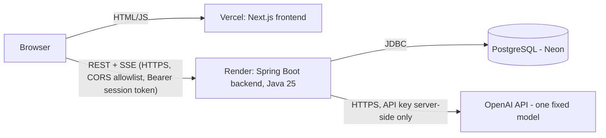
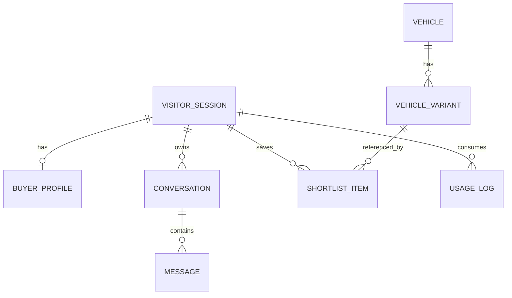
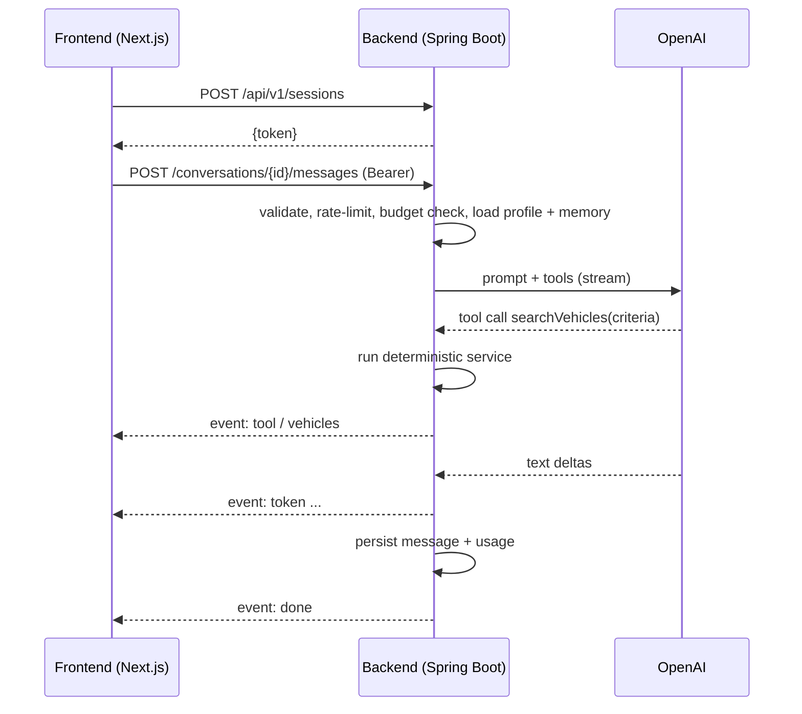
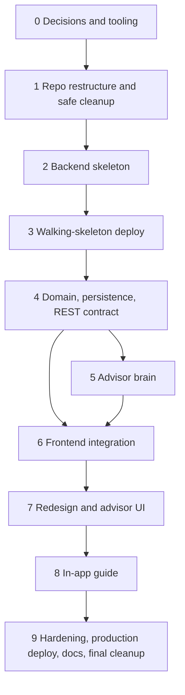

# CPA — Car Purchase Advisor: transformation plan

> Status: **final — decisions D1–D9 approved on 2026-11-11 (recommended options). Ready for implementation; start with §12.** No code has been changed yet.
> Date: 2026-11-11
> Scope: turn the current SkillForge repo (Next.js career copilot) into a full-stack car purchase advisor: React + TypeScript frontend, Java 25 / Spring Boot backend, both deployed in the cloud.
> This file is the execution roadmap. `docs/requirements.md` is rewritten as the new source of truth in Phase 1; until then, where the two conflict, this plan wins for the CPA work. This file stays in English; every other file under `docs/` is written in Romanian (D1).

---

## 1. Findings from the repo analysis

### 1.1 What exists today

| Area               | Current state                                                                                                                                                  |
| ------------------ | -------------------------------------------------------------------------------------------------------------------------------------------------------------- |
| Architecture       | **Single Next.js 16 app** (React 19, TS, Tailwind v4, shadcn/ui). UI and "backend" (Route Handlers) live in the same project, deployed on Vercel.               |
| LLM access         | Vercel AI SDK (`ai`, `@ai-sdk/react`, `@ai-sdk/anthropic`, `@ai-sdk/openai`) called from `src/app/api/chat/route.ts`; provider registry in `src/lib/providers*.ts`. |
| Persona            | `src/lib/system-prompt.ts` — career-mentor prompt built from a skills profile.                                                                                  |
| State              | Zustand + `persist` in `localStorage` (`skillforge-app`); theme in a separate context (`skillforge-theme`). No database.                                        |
| Auth               | Auth.js v5 with GitHub; optional in dev, mandatory for the chat route in production.                                                                           |
| Cost / cache / RL  | `src/lib/cost.ts`, `src/lib/cache.ts`, in-memory rate limiter in the chat route (10 req/min, per instance).                                                     |
| Docs               | `docs/requirements.md` (SkillForge phases), `docs/{anthropic,openai,nextauth,vercel}/README.md`, `docs/_template/`, `README.md` (includes a Vite-vs-Next section). |
| Agent tooling      | `AGENTS.md` → generated `CLAUDE.md` and `.github/copilot-instructions.md`; skills `pre-deploy` and `add-provider` in `.claude/skills` mirrored in `.github/skills`. |
| Git                | `main` only, remote `origin` on GitHub. History uses "Finalized step N" messages.                                                                              |
| Local toolchain    | Node 20.12, **JDK 17 only, no Maven** → JDK 25 must be installed; use the Maven Wrapper (`mvnw`) so no global Maven is needed.                                   |

### 1.2 Key observation

The request says "keep React + TypeScript and add a Java microservice". Today the repo is already a "full-stack" Next.js app whose server half is TypeScript. Making the Java service the real backend therefore means **moving every server responsibility out of Next.js** (LLM call, system prompt, cost, cache, rate limit, auth checks, persistence) and leaving Next.js as a pure UI. Half-migrating (both servers calling the LLM) is the main trap to avoid.

### 1.3 Keep / transform / remove inventory

| Item                                                                                                  | Decision                                                                                                   |
| ----------------------------------------------------------------------------------------------------- | ---------------------------------------------------------------------------------------------------------- |
| Next.js + React + TS + Tailwind v4 + shadcn/ui, `components/ui/*`, `use-mobile`, `utils.ts`            | **Keep** (moves to `frontend/`)                                                                            |
| Sidebar / header / chat list / message / composer / Markdown renderer / settings dialog shell          | **Transform** (re-skin and re-purpose)                                                                     |
| Manual SSE parsing in `settings/about-form.tsx`                                                        | **Extract** the logic into `lib/sse.ts` and reuse for the new chat stream, then delete the form            |
| `profile-form.tsx` (skills profile)                                                                    | **Replace** with a buyer-needs profile                                                                     |
| `src/app/api/chat`, `api/providers`, `lib/providers*.ts`, `lib/system-prompt.ts`, `lib/cost.ts`, `lib/cache.ts` | **Remove** — responsibilities move to the Java backend                                                     |
| `@ai-sdk/*`, `ai` dependencies                                                                         | **Remove** (new custom SSE contract, see §2.4)                                                             |
| Auth.js (`lib/auth.ts`, `api/auth`, `components/auth/*`, `next-auth`)                                  | **Remove** (D3: anonymous session token)                                |
| `src/app/demo`, `api/hello`, `api/about`, `Counter.tsx`, `ServerInfo.tsx`, `settings/about-form.tsx`, `providers-form.tsx` | **Remove** (course demos / old purpose)                                                                    |
| `src/lib/mock/*`                                                                                       | **Remove** (conversations, profile are SkillForge-specific)                                                |
| `public/*.svg` (Next/Vercel boilerplate)                                                               | **Remove**                                                                                                 |
| `docs/anthropic`, `docs/nextauth`, `docs/openai` (old), Vite-vs-Next section in `README.md`            | **Remove / rewrite**                                                                                       |
| `.claude/skills/add-provider` + `.github/skills/add-provider`                                          | **Remove** (single model, no provider registry)                                                            |
| `pre-deploy` skill, `AGENTS.md` / `CLAUDE.md` / `.github/copilot-instructions.md`, sync scripts        | **Rewrite** for two services; keep the generate-from-one-source mechanism                                   |
| `shadcn` and (verify) `next-themes` in `dependencies`                                                  | **Move/remove** — run `knip` or `depcheck` during the cleanup audit                                        |
| localStorage keys `skillforge-app`, `skillforge-theme`                                                 | **Replace** with `cpa-*`; no migration needed (new product, no users to preserve)                          |

---

## 2. Target architecture



Principles:

1. **The browser never touches OpenAI and never sees the key.** The key exists only as `OPENAI_API_KEY` on the backend host.
2. **The backend owns all product logic and all data**: persona prompt, tools, scoring, TCO maths, memory, rate/budget limits, persistence. The frontend renders and collects input.
3. **Contract-first**: the REST/SSE contract is defined and documented before either side is built; the frontend generates its TypeScript types from the backend's OpenAPI document.
4. **The LLM never does arithmetic or invents specs.** Prices, costs, rankings and comparisons come from deterministic Java services exposed to the model as tools; the model explains and converses.
5. **Walking skeleton first**: deploy an empty-but-connected frontend + backend early to flush out CORS, SSE-through-proxy and cold-start problems.

### 2.1 Target repository layout

```
cpa-car-purchase-advisor/
├── README.md                    # what it is, structure, quick start for both services, links
├── AGENTS.md  CLAUDE.md  .github/copilot-instructions.md
├── docker-compose.yml           # local PostgreSQL (+ optionally backend)
├── render.yaml                  # backend infrastructure-as-code
├── .github/workflows/           # frontend.yml, backend.yml
├── scripts/                     # sync scripts, commit-msg hook
├── docs/
│   ├── README.md                # index
│   ├── requirements.md          # source of truth (rewritten)
│   ├── plan.md                  # this file
│   ├── architecture/{backend,frontend,communication}.md
│   ├── adr/                     # short architecture decision records
│   └── {openai,render,neon,vercel}/README.md
├── frontend/                    # Next.js app (moved with `git mv`, history preserved)
│   └── src/{app,components,hooks,lib/api,lib/sse.ts,store}
└── backend/                     # Spring Boot 4.x, Maven wrapper, Java 25
    ├── Dockerfile
    └── src/{main,test}/java/ro/cpa/advisor/
        ├── api/          # controllers, DTOs (records), SSE, exception handler (ProblemDetail)
        ├── service/      # application services (use cases): advisor, conversation, shortlist, tco
        ├── domain/       # entities, value objects, scoring/TCO rules (no framework dependencies)
        ├── repository/   # Spring Data JPA repositories
        ├── ai/           # Spring AI config, system prompt builder, tools, guardrails, memory
        └── config/       # CORS, security filter, rate limiting, typed @ConfigurationProperties
```

(Base package `ro.cpa.advisor` and artifact `cpa-backend` are fixed by D9.)

### 2.2 Backend design

**Stack:** Java 25, latest stable Spring Boot 4.x (verify Spring AI compatibility at kickoff; fall back to the newest Boot line Spring AI supports), Maven Wrapper, Spring Web MVC with **virtual threads** (`spring.threads.virtual.enabled=true`), Spring Data JPA, Flyway, Bean Validation, Spring Security (stateless filter only), Actuator, springdoc-openapi, **Spring AI** (OpenAI starter), Bucket4j (rate limiting), Micrometer.

**Layering rules** (enforced by an ArchUnit test so they cannot rot):
`api → service → repository`, `service → domain`, `ai` is used by `service` only; `domain` depends on nothing; controllers never touch repositories or Spring AI directly.

**Database (lightweight):** JPA + Flyway migrations. **H2** for local dev/tests that do not need Postgres semantics; **PostgreSQL (Neon free tier) in production**. Reason: free container hosts have ephemeral disks, so an H2/SQLite file would be wiped on every deploy. Same migrations run on both; Testcontainers covers Postgres-specific behaviour in CI.



- `visitor_session` — id, token hash (never the raw token), created/last-seen.
- `buyer_profile` — budget (total or monthly), financing mode, yearly km, city/highway mix, passengers, body types, powertrains, home charging, new/used, must-haves, deal-breakers.
- `conversation` / `message` — messages carry JSON metadata (token usage, tool calls, vehicle cards shown); `conversation.summary` holds the rolling summary used to cap context.
- `vehicle` / `vehicle_variant` — curated catalogue (seeded by Flyway/CSV): price, powertrain, consumption, CO2, boot size, safety rating, reliability notes, running-cost inputs.
- `shortlist_item`, `usage_log` (daily token/cost accounting per session and global).

**AI layer (all in package `ai`):**

- **One** place builds the system prompt (carried-over rule from SkillForge), versioned and unit-tested.
- Single model from configuration (`cpa.llm.model`, one value, no selector anywhere) and `OPENAI_API_KEY` placeholder. Missing key → app still boots; advisor endpoint returns a typed `503 advisor-not-configured` problem and the UI shows a friendly state.
- Tools exposed to the model via Spring AI `@Tool` (see §4).
- Chat memory: last N messages + rolling summary + structured buyer profile injected as data, not instructions (same delimiter/untrusted-data technique as the current prompt).

### 2.3 Frontend design

- Stays Next.js 16 + TS + Tailwind v4 + shadcn/ui (the stack rule "no hand-written CSS, no second component library" is kept; the new look is achieved through design tokens and component composition).
- Becomes a **pure client of the backend**: no Route Handlers at all (pages only). Env: only `NEXT_PUBLIC_API_BASE_URL` (public by definition).
- Server state through **TanStack Query** (conversations, profile, shortlist); UI/session state in the existing Zustand store (`cpa-app`: session token + UI prefs only — data now lives in the DB).
- Chat via a custom `useAdvisorChat` hook: `fetch` + `ReadableStream` SSE parser (`EventSource` cannot POST or set headers), `AbortController` for stop.
- API types generated from OpenAPI (`openapi-typescript`) into `lib/api/schema.d.ts`, so a contract change breaks the build instead of production.
- Vitest + Testing Library for the SSE parser, hook and key components; one Playwright smoke test optional.

### 2.4 Frontend ↔ backend communication (best-practice choices)

| Concern          | Decision                                                                                                                                                                                                  |
| ---------------- | --------------------------------------------------------------------------------------------------------------------------------------------------------------------------------------------------------- |
| Style            | REST/JSON under `/api/v1`, plus one **SSE** endpoint for streamed answers. WebSockets are unnecessary (one-directional stream).                                                                            |
| Streaming        | `POST /api/v1/conversations/{id}/messages` → `text/event-stream`. Heartbeat comment every ~15 s and `X-Accel-Buffering: no` so proxies do not buffer or drop the stream.                                    |
| Identity         | `POST /api/v1/sessions` returns an opaque random token (stored hashed server-side); the SPA keeps it in `localStorage` and sends `Authorization: Bearer`. Chosen over cookies because the two origins differ (`*.vercel.app` vs backend) and third-party cookies are blocked by Safari/Chrome. |
| CORS             | Explicit allowlist from `CORS_ALLOWED_ORIGINS` (prod URL + local); no `*`. Preview deployments are added deliberately or tested against a fixed preview alias.                                              |
| Errors           | RFC 9457 `ProblemDetail` (`type`, `title`, `status`, `detail`, `code`, `requestId`); a mapper turns `code` into Romanian/English UI copy. Never stack traces or key hints.                                |
| Versioning       | URL prefix `/api/v1`; additive changes only inside a version.                                                                                                                                              |
| Contract         | springdoc OpenAPI at `/v3/api-docs`, committed snapshot `docs/architecture/openapi.json`, CI fails if the snapshot is stale.                                                                              |
| Observability    | `X-Request-Id` generated by the frontend/echoed by the backend and put in every log line.                                                                                                                  |

**SSE event contract** (own protocol, documented in `docs/architecture/communication.md`):

| Event      | Payload                                                         | Purpose                                         |
| ---------- | --------------------------------------------------------------- | ----------------------------------------------- |
| `meta`     | `{messageId, conversationId}`                                   | Start of the answer                             |
| `token`    | `{delta}`                                                       | Streamed text                                   |
| `tool`     | `{name, status: started\|finished, summary}`                    | "Calculating total cost of ownership…" in UI    |
| `vehicles` | `{cards: VehicleCard[]}`                                        | Render cards instead of Markdown tables         |
| `compare`  | `{vehicles, criteria, scores}`                                  | Comparison widget                               |
| `profile`  | `{patch}`                                                       | Buyer profile updated by the agent (side panel) |
| `error`    | `ProblemDetail`                                                 | Mid-stream failure                              |
| `done`     | `{usage: {input, output}}`                                      | End of stream                                   |



---

## 3. Decisions (all approved on 2026-11-11 — the bold option is the chosen one)

Changing any of these later requires an ADR in `docs/adr/` and an update of this plan.

| #   | Decision                              | Options                                                                                           | Approved choice / why                                                                                                                                                 |
| --- | ------------------------------------- | ------------------------------------------------------------------------------------------------- | --------------------------------------------------------------------------------------------------------------------------------------------------------------------- |
| D1  | Target market, currency, language     | Romania/EU vs US; RO vs EN UI                                                                     | **Romania/EU, EUR (with RON conversion), UI + `docs/` in Romanian, code/commits in English** — matches the current repo rules; i18n RO/EN is a stretch goal. Car prices, taxes (e.g. road tax, RCA/CASCO) and fuel prices depend on this, so it is fixed first. Only this plan file is in English. |
| D2  | Frontend framework                    | Keep Next.js vs rewrite as Vite SPA                                                               | **Keep Next.js**: zero rewrite cost, Vercel deploy already documented; used purely as UI.                                                                              |
| D3  | Identity                              | Anonymous session token vs keep GitHub login                                                      | **Anonymous session token** (no PII, nothing to leak, lower friction); optional login stays a stretch goal. Cost abuse is handled by rate limit + daily budget instead. |
| D4  | Backend hosting                       | Render, Fly.io, Railway, Google Cloud Run                                                         | **Render (Docker web service, free) + Neon Postgres (free)**. Trade-off: free tier sleeps → cold start; mitigated by a "waking up the advisor" UI state and optional uptime ping. Fly.io/Cloud Run are better but need a card. |
| D5  | Database                              | H2 only, SQLite, Postgres                                                                         | **H2 (dev) + Postgres (prod)**, Flyway migrations (see §2.2).                                                                                                          |
| D6  | Vehicle data                          | Curated seed dataset, live API, LLM memory                                                        | **Curated seed (~100–200 variants of popular models) maintained in the repo**, with a "data as of" date shown in the UI. Live sources (e.g. NHTSA recalls) are an optional extra. The LLM must never answer specs/prices from memory. |
| D7  | OpenAI model                          | `gpt-5`, `gpt-5-mini`; updated 2026-11-11: `gpt-5.6-terra`, `gpt-6.1-terra`, `gpt-6-luna`         | **`gpt-5.6-terra`** (ADR 0010, accepted and confirmed by the owner on 2026-11-11), a single property to change it. It supersedes `gpt-5-mini` (ADR 0007), deprecated with shutdown on 2026-12-11. Chosen because it supports function calling through Chat Completions, which is all Spring AI 2.0.2 speaks; the cheaper GPT-6.x models need the Responses API for tool calling. |
| D8  | Java AI library                       | Spring AI, LangChain4j, raw OpenAI SDK                                                            | **Spring AI** (ChatClient, `@Tool`, advisors for memory, structured output, native Boot integration).                                                                 |
| D9  | Java base package / artifact naming   | e.g. `ro.cpa.advisor`                                                                             | **`ro.cpa.advisor`**, artifact `cpa-backend`.                                                                                                                          |

---

## 4. Making the advisor "as clever as possible"

### 4.1 Core intelligence (Must)

1. **Guided discovery.** The agent interviews progressively instead of dumping an interrogation: budget (cash vs monthly), yearly km, city/highway mix, passengers, parking/home charging, new vs used, must-haves/deal-breakers. Answers are extracted into the structured buyer profile via the `updateBuyerProfile` tool and shown live in a side panel the user can edit.
2. **Tool-grounded answers.** Tools implemented in Java and exposed through Spring AI:
   - `searchVehicles(criteria)` — filter the catalogue by the profile.
   - `rankVehicles(profile, candidateIds)` — **weighted multi-criteria scoring** (price fit, running cost, space, safety, reliability, fit with usage), returning a per-criterion breakdown so every recommendation has an explainable "why this car".
   - `compareVehicles(ids)` — side-by-side data.
   - `calculateTco(variant, years, kmPerYear, fuelOrEnergyPrice, financing)` — purchase, depreciation, energy, insurance, tax, maintenance, interest.
   - `calculateFinancing(price, downPayment, apr, months)` — monthly rate and total interest.
   - `evVsIceBreakEven(...)` — when does an EV pay off for this user's mileage and charging access.
   - `addToShortlist` / `getShortlist`.
3. **Guardrails.**
   - Hard rule: prices, specs and costs must come from tool results; if a tool has no data, the agent says so.
   - Always label prices as indicative with the "data as of" date; no financial/legal guarantees.
   - Scope: cars and purchase decisions only; polite redirect otherwise.
   - Prompt-injection hygiene: profile, listing text and user input are delimited data, never instructions; input length caps; output never reveals the system prompt.
4. **Memory.** Messages persisted in the DB; rolling summary + the structured profile feed the next turn so token cost stays bounded in long chats.

### 4.2 Strong extras (Should)

- **Paste-a-listing analysis:** user pastes a used-car ad → agent extracts structured fields, flags red flags (mileage/age mismatch, vague history, too-good price) and generates questions for the seller and a pre-purchase inspection checklist.
- **Purchase journey stages** (discovery → shortlist → compare → financing → inspection/test drive → negotiation) with quick-reply chips and a stage indicator, so the chat feels like a guided product rather than an open prompt box.
- **Negotiation helper:** target price range, leverage points, and a short script.
- **Shareable summary:** export shortlist + comparison + TCO as Markdown/PDF (the current JSON/Markdown export code is a starting point).
- **Evaluation harness:** a golden set of ~20 buyer scenarios with assertions (tool called, numbers match the Java calculator, no invented models) plus prompt versioning; opt-in test that needs the real key.

### 4.3 Stretch (Could)

- RAG over a small buying-guide knowledge base (pgvector on Neon).
- Optional GitHub/Google login to keep history across devices.
- RO/EN i18n.
- Live data (recalls, fuel prices) with a cache layer.

### 4.4 Reference acceptance scenarios (replace the old §3 "reference questions")

1. _"I have €20,000, drive ~15,000 km/year mostly in the city and I can't charge at home. Petrol, hybrid or electric?"_ → asks only what is missing, calls the TCO/EV-vs-ICE tools, numbers match the calculator, recommendation is justified by the profile.
2. _"Compare a Golf, a Corolla and an Octavia for a family of four over 5 years."_ → comparison widget with TCO and a scored breakdown, not an invented table.
3. _[pasted listing]_ _"Is this a good deal?"_ → extracted facts, red flags, seller questions, inspection checklist; no fabricated history.
4. An off-topic or prompt-injection attempt → polite redirect, no rule leakage.

---

## 5. Frontend redesign and in-app guide

### 5.1 Design direction

Goal: a distinctive, polished, automotive-flavoured identity instead of the generic chat-clone look.

- **Concept: "instrument cluster / showroom at night."** Dark-first with a warm light theme counterpart (theme stays a setting; keep the rule that the header has no theme toggle — revisit if desired).
- **Layout:** three zones — slim navigation (conversations, shortlist, guide), the conversation, and a **live side panel** ("Your needs" profile chips, current shortlist, running TCO) that updates as the agent works. On mobile the panel becomes a bottom sheet.
- **Signature components:** vehicle cards with score ring and badges, a comparison table with per-criterion bars, TCO breakdown as stacked bar/gauge, budget slider with monthly-vs-total toggle, journey-stage stepper, tool-activity chips ("Comparing 3 vehicles…").
- **Tokens:** a new palette (deep graphite + signal amber/teal accent), tighter radius scale, display font for headings + tabular/mono numerals for prices; all defined as shadcn tokens in `globals.css` (`:root` and `.dark`, as the current rule requires). No hand-written component CSS.
- **Quality bar:** responsive to 360 px, keyboard navigable, `aria-live` for streaming text, reduced-motion respected, skeletons and meaningful empty/error/cold-start states, Lighthouse accessibility ≥ 90.

### 5.2 In-app "How to use" guide

- **Entry points:** a "Guide" item in the sidebar, a `?` shortcut, and a first-visit onboarding dialog (skippable, shown once, flag stored in `cpa-app`).
- **Content (data-driven registry, per the repo's "registry, not if-chains" rule, as `lib/guide.ts`):** what the advisor can do; how to get good answers (give budget, usage, constraints); example prompts the user can click to prefill the composer; how to read vehicle cards, scores and TCO; how to use shortlist/profile panel; limits and disclaimers (indicative prices, data date); privacy note and "delete my data".
- **Contextual help:** tooltips/glossary for TCO, APR, depreciation; empty-state prompt chips mapped to the journey stages.
- Built with existing shadcn primitives (`dialog`, `tabs`/`accordion` added via `npx shadcn@latest add`).

---

## 6. Deployment

| Piece      | Where                       | How                                                                                                                                                                                                  |
| ---------- | --------------------------- | ---------------------------------------------------------------------------------------------------------------------------------------------------------------------------------------------------- |
| Frontend   | Vercel (existing)           | Project root directory `frontend`; env `NEXT_PUBLIC_API_BASE_URL`; Preview per branch, Production from `main`.                                                                                      |
| Backend    | Render (Docker web service) | Multi-stage `Dockerfile` (Temurin 25 JDK build → 25 JRE runtime, non-root, layered jar), health check `/actuator/health`, `render.yaml` blueprint, auto-deploy from `main` with root dir `backend`.      |
| Database   | Neon Postgres               | `DATABASE_URL`/`SPRING_DATASOURCE_*` via env; Flyway runs on boot.                                                                                                                                  |
| Secrets    | Host dashboards only        | `OPENAI_API_KEY` (placeholder now), DB credentials, `CORS_ALLOWED_ORIGINS`, session-hash secret. `.env.example` files contain placeholders only; nothing real in `docs/`.                           |
| JVM tuning | Container flags             | Small heap (`-XX:MaxRAMPercentage`), `-XX:+UseSerialGC`, JDK 25 AOT cache / Spring AOT to shorten cold start on the free tier.                                                                       |
| CI         | GitHub Actions              | `frontend.yml` (lint, format:check, test, build); `backend.yml` (`./mvnw verify` incl. ArchUnit and Testcontainers, OpenAPI snapshot check, Docker build).                                          |

Protection of a public, paid endpoint (required before the key is real): per-session and per-IP rate limit (Bucket4j), **daily token/cost budget** with a global kill switch, max prompt length, max messages per conversation, `max_output_tokens`, and a "limit reached" UI state.

Cold-start UX: the frontend pings `/actuator/health` on load and shows "Waking up the advisor…" instead of a failed request.

Integration docs (mandatory per repo rules, using `docs/_template/README.md`): `docs/openai/` (rewritten, single model, placeholder key), `docs/render/`, `docs/neon/`, `docs/vercel/` (updated); each with an index row in `docs/README.md`.

---

## 7. Documentation deliverables

| File                                          | Content                                                                                                            |
| --------------------------------------------- | ------------------------------------------------------------------------------------------------------------------ |
| `README.md` (root)                            | Purpose, live URLs, repo tree (`frontend/`, `backend/`, `docs/`, `scripts/`), quick start for each service, env vars, commit convention, doc links. |
| `docs/requirements.md`                        | Rewritten: product vision, personas (first-time buyer, family, EV-curious, used-car hunter), phases, non-functional requirements (cost, privacy, performance, availability), non-goals. |
| `docs/architecture/backend.md`                | Layered architecture, package responsibilities, dependency rules, DB schema + migrations, AI layer, tools, security, testing strategy, config reference. |
| `docs/architecture/frontend.md`               | Folder structure, state model (TanStack Query vs Zustand), SSE hook, design system/tokens, component conventions, testing. |
| `docs/architecture/communication.md`          | Sequence diagrams, REST endpoints, SSE event spec, session/auth, CORS, error model, versioning, type generation. |
| `docs/adr/000N-*.md`                          | One short ADR per D1–D9 decision, so the reasoning survives.                                                       |
| `AGENTS.md` (+ regenerated copies)            | Rewritten for two services: key only in backend, contract-first, layering rules, who owns which responsibility, new commit convention. |

Docs are written alongside each phase, not postponed to the end; Phase 9 only polishes and verifies them.

---

## 8. Git conventions

- Naming (from Phase 10 on; earlier history keeps `CPA-<short-kebab-title>`): branches `CPA-<issue number>-<kebab-message>`, commits and PR titles `CPA-<issue number> <message>`, e.g. `CPA-42-add-google-login` and `CPA-42 Add Google login`. Enforced by `scripts/check-naming.sh`, used by the versioned `commit-msg` and `pre-push` hooks in `scripts/hooks/` (activated with `git config core.hooksPath scripts/hooks`) and by the `naming` CI check (`.github/workflows/naming.yml`), which should be a required status check on `main`.
- One branch per issue, merged into `main` through a PR so Vercel/Render previews and CI run before `main` changes; small, single-purpose commits inside the branch.
- Pure moves (`git mv`) go in their own commit with no content edits to keep history and blame intact.
- `main` must stay deployable: dead code that the old UI still imports is removed only after its replacement exists (see Phase 1 vs Phase 6).

---

## 9. Sequencing



### Phase 0 — Decisions and tooling
- D1–D9 are approved; record each as a short ADR in `docs/adr/`.
- Install JDK 25 (Temurin); verify `java -version`. No global Maven (wrapper).
- Create `scripts/hooks/commit-msg`; commit this plan: `CPA-added-transformation-plan`.
- **Done when:** decisions signed off, `java -version` shows 25, hook rejects a bad message.

### Phase 1 — Repo restructure and safe cleanup
- `git mv` the Next.js project (src, public, configs, package files, Prettier/ESLint/TS configs) into `frontend/`; fix paths in scripts, `.gitignore`, `components.json`, sync scripts, skills. Pure-move commit first: `CPA-moved-frontend-to-subfolder`.
- Rename package `skill-forge` → `cpa-frontend`; rename localStorage keys.
- **Wave 1 cleanup (nothing the app still imports):** `demo`, `api/hello`, `api/about`, `Counter`, `ServerInfo`, boilerplate SVGs, `add-provider` skill. Commit: `CPA-removed-demo-and-boilerplate`.
- Rewrite `docs/requirements.md` and `AGENTS.md` skeleton (+ regenerate copies); root `README.md` first version.
- **Done when:** `cd frontend && npm run build && npm run lint && npm run format:check` pass; app still runs as before; no files left outside `frontend/ docs/ scripts/ .github/ .claude/` apart from root meta files.

### Phase 2 — Backend skeleton
- Generate the project (Initializr dependencies: Web, Validation, Data JPA, Flyway, PostgreSQL, H2, Security, Actuator, Spring AI OpenAI, springdoc) under `backend/` with Java 25 and Maven Wrapper.
- Layered packages, typed `@ConfigurationProperties`, `ProblemDetail` exception handler, CORS from env, request-id filter, `GET /api/v1/health`-style info endpoint, OpenAPI, ArchUnit layering test, first unit + `@WebMvcTest`.
- `Dockerfile`, `.env.example`, `backend.yml` CI.
- Commit: `CPA-added-backend-service`.
- **Done when:** `./mvnw verify` green, `docker build` works, app boots without `OPENAI_API_KEY`.

### Phase 3 — Walking-skeleton deploy
- Deploy backend (Render + Neon) and point the Vercel frontend at it; a trivial "backend status" call from the UI proves CORS and HTTPS end to end; observe cold start.
- Write `docs/render`, `docs/neon`, update `docs/vercel`.
- Commit: `CPA-deployed-skeleton`.
- **Done when:** public frontend URL shows backend status fetched from the public backend URL.

### Phase 4 — Domain, persistence and REST contract
- Flyway migrations and entities from §2.2; seed catalogue; repositories; services; controllers for sessions, profile, conversations, messages (non-AI), shortlist, vehicles; Bearer-session filter; Bucket4j rate limit; usage/budget accounting.
- Publish OpenAPI snapshot; write `docs/architecture/communication.md` and `backend.md` (first version).
- Tests: service and repository slices (Testcontainers), controller contract tests.
- Commits: `CPA-added-domain-model`, `CPA-added-rest-api`.
- **Done when:** full CRUD works through Swagger UI with a session token; the contract document matches the snapshot.

### Phase 5 — Advisor brain
- 5a `CPA-added-llm-streaming`: Spring AI ChatClient, single model from config, system prompt builder, SSE endpoint, persistence of streamed messages, missing-key state.
- 5b `CPA-added-advisor-tools`: `updateBuyerProfile`, `searchVehicles`, `compareVehicles`, shortlist tools, SSE `tool`/`vehicles`/`profile` events.
- 5c `CPA-added-scoring-and-tco`: scoring engine, TCO, financing, EV-vs-ICE (pure domain code, heavy unit tests), `compare` event.
- 5d `CPA-added-guardrails-and-eval`: guardrails, injection tests, memory summarisation, golden-scenario eval suite.
- **Done when:** the four acceptance scenarios (§4.4) pass against the real model (or a recorded stub in CI); cost per answer logged.

### Phase 6 — Frontend integration
- `lib/api` client + generated types, `lib/sse.ts`, session bootstrap, TanStack Query, `useAdvisorChat`, backend-backed conversations/profile/shortlist, buyer-needs form replacing the skills profile, error and cold-start states.
- **Wave 2 cleanup:** delete `api/chat`, `api/providers`, `lib/providers*`, `lib/system-prompt`, `lib/cost`, `lib/cache`, `lib/mock`, Auth.js pieces (per D3), `providers-form`, `ai`/`@ai-sdk/*`/`next-auth` dependencies; run `knip`/`depcheck`.
- Commits: `CPA-connected-frontend-to-backend`, `CPA-removed-legacy-server-code`.
- **Done when:** the app works end to end locally (frontend + backend + Postgres via `docker-compose`) and no code path in Next.js calls an LLM.

### Phase 7 — Redesign and advisor UI
- Tokens, typography, layout with side panel, vehicle card, comparison, TCO widgets, journey stepper, tool-activity chips, shortlist view, responsive/mobile sheet, a11y pass.
- Commits: `CPA-redesigned-ui-shell`, `CPA-added-advisor-components`.
- **Done when:** visual review on desktop and 390 px width, keyboard-only run through the main flow, axe/Lighthouse checks pass.

### Phase 8 — In-app guide
- Onboarding dialog, Guide page/dialog, example prompts, glossary tooltips, `lib/guide.ts` registry.
- Commit: `CPA-added-in-app-guide`.
- **Done when:** a new visitor can complete the first scenario using only what the UI teaches.

### Phase 9 — Hardening, production deploy, docs and final cleanup
- Real `OPENAI_API_KEY` in the Render dashboard (never in the repo); budget cap and kill switch verified; CORS locked to production origin; load/abuse smoke test; rewrite `pre-deploy` skill for two services (build without env files, format, tests, OpenAPI snapshot, env var checklist, health URLs).
- Finish `frontend.md`, polish `backend.md`, root `README.md` with live URLs, `docs/README.md` index, regenerated `CLAUDE.md` / `.github/copilot-instructions.md`.
- **Cleanup audit:** `git grep -i -E "skillforge|skill-forge|career|carieră|anthropic|learning|mentor"` returns nothing (except history/ADR mentions); `knip`/`depcheck` clean; no orphan files, dead env vars, unused shadcn components; `.env.example` files match code.
- Commits: `CPA-deployed-production`, `CPA-finalized-docs`, `CPA-final-cleanup`.
- **Done when:** the public URL works from a phone, a full scenario runs on production, the repo audit is clean, and the Definition of Done below holds.

---

## 10. Risks and mitigations

| Risk                                                       | Mitigation                                                                                                              |
| ---------------------------------------------------------- | ----------------------------------------------------------------------------------------------------------------------- |
| Public endpoint burns the OpenAI budget                    | Rate limit + daily budget + kill switch + output/input caps; provider-side spending limit on the OpenAI account.         |
| Model hallucinates prices/specs                            | Tool-grounded answers, "data as of" label, evaluation suite asserting no un-sourced numbers.                            |
| Catalogue gets stale                                       | Versioned seed data with a date, simple refresh script, visible disclaimer.                                             |
| Free-tier cold start (30–60 s) makes the demo feel broken  | Wake-up UI state, health ping, JVM/AOT tuning; documented upgrade path to an always-on plan.                            |
| SSE dropped or buffered by proxies                         | Heartbeats, no-buffering headers, walking-skeleton test in Phase 3.                                                     |
| CORS surprises with Vercel preview URLs                    | Explicit allowlist strategy decided in Phase 3; previews tested against a stable alias.                                 |
| Spring AI / Spring Boot / Java 25 version mismatch         | Verify the compatibility matrix at Phase 2 start; pin versions; fall back to the newest supported Boot line if needed. |
| Free Postgres suspends/expires                             | Neon auto-wake handled by connection retry; documented backup/export script; ADR notes the alternative.                 |
| Users share financial details in chat                      | No PII collected, no login, "delete my data" endpoint, privacy note in the guide, no personal data in logs.             |
| Big-bang breakage of `main` during migration               | Two-wave cleanup, one PR per phase, CI on every PR.                                                                     |

---

## 11. Definition of done (whole project)

1. `frontend/` and `backend/` each build and test green in CI; `docker-compose up` runs the full stack locally.
2. Public frontend URL talks to the public backend URL; streaming works on mobile networks.
3. Exactly one OpenAI model is used, configured in one backend property; no model selector exists in UI or code.
4. The OpenAI key exists only in the backend host's environment; `.env.example` files hold placeholders.
5. The four acceptance scenarios behave as specified.
6. The in-app guide is reachable from the main screen and on first visit.
7. README, requirements, architecture docs (backend, frontend, communication), ADRs and integration docs reflect reality; agent instruction files regenerated.
8. The repo cleanup audit (Phase 9) is clean and every commit on the branch history for this work uses the `CPA-` tag.

---

## 12. Implementation kickoff

### 12.1 Prerequisites (owner: you; nothing here needs a real key yet)

- [ ] Install **JDK 25** (Temurin) and point `JAVA_HOME` to it; `java -version` must report 25 (current machine has 17).
- [ ] Keep Node 20.9+ (current 20.12 is fine for Next 16); Docker Desktop for local Postgres and image builds.
- [ ] Accounts (free tiers): GitHub (exists), Vercel (exists), **Render**, **Neon**. Needed from Phase 3.
- [ ] OpenAI account and key: only needed at Phase 5d/9; until then `OPENAI_API_KEY="your_openai_api_key"` stays a placeholder. Set a monthly spending limit in the OpenAI dashboard when the key is created.

### 12.2 Verify at the start of Phase 2 (facts that change over time)

- Spring Boot / Spring AI / Java 25 compatibility: pick the newest Spring Boot line that the current Spring AI release officially supports; pin both versions in the `pom.xml`.
- OpenAI model id for D7 against the OpenAI model list and its current pricing; record the date in `docs/openai/README.md`.
- Render supports the chosen Temurin 25 base image; Neon free-tier limits (storage, auto-suspend). **Verified 2026-11-11 (Phase 3):** Render builds multi-stage Dockerfiles from public images, injects `PORT` (default 10000, which `backend/Dockerfile` honors), Free = 0.1 CPU / 512 MB, spins down after 15 min; Neon Free = 1 GB/project, 100 CU-hours/project, scale-to-zero after 5 min (fixed), wake-up in a few hundred ms. Details and sources in `docs/render/README.md` and `docs/neon/README.md`; the first real Render build is the final confirmation.

### 12.3 First actions, in order

1. Create branch `cpa/phase-0-1-restructure`.
2. Add `scripts/hooks/commit-msg` (regex `^CPA-[a-z0-9]+(-[a-z0-9]+)*$` on the first line) and run `git config core.hooksPath scripts/hooks`.
3. Commit the plan and the ADRs for D1–D9: `CPA-added-transformation-plan`.
4. `git mv` the frontend files into `frontend/` (one commit, no content changes): `CPA-moved-frontend-to-subfolder`.
5. Fix paths, rename package and storage keys, run `cd frontend && npm install && npm run build && npm run lint && npm run format:check`.
6. Wave 1 cleanup (Phase 1), then rewrite `docs/requirements.md`, `AGENTS.md` and the root `README.md`; open the PR.
7. Continue with Phase 2 on a new branch, following §9.

### 12.4 Working rules for every phase

- Code, identifiers and commits in English; UI copy and `docs/` (except this file) in Romanian; comments explain WHY (existing repo convention).
- Each phase ends with: builds and tests green, the "done when" check satisfied, the docs for that phase written, `npm run format` (frontend) run, and a short explanation of what was added and why.
- New integration → `docs/<integration>/README.md` from `docs/_template/README.md` + index row + `.env.example` placeholders in the same commit.
- Never commit real keys; real values live only in `.env.local` (frontend), `backend/.env` (gitignored) and the host dashboards.
- Commit only when you ask for it, always as `CPA-<short-title>`.
